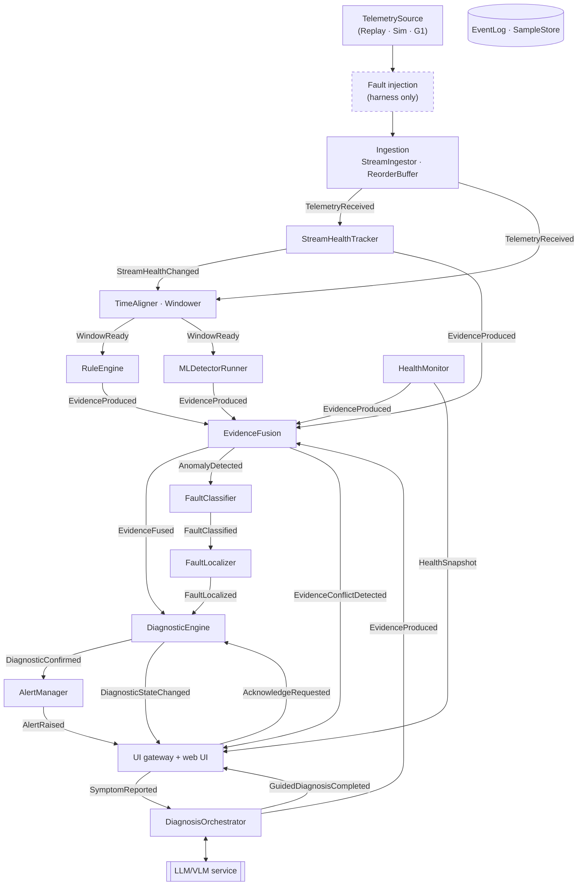

# Component view

!!! proposed "Proposed"
    Refines the components named in the proposal and the team's Design Document outline.

## Component diagram

Every arrow between stages travels through the event bus and is labelled with the event carried. The bus itself is omitted to keep the flow readable.

`EventLog` subscribes to every topic. `HealthMonitor` also receives every stage's heartbeat and queue statistics; those arrows are not drawn.

## Why the engine does not sit at the end of a single chain

The proposal writes the stages as `AnomalyDetector → FaultClassifier → FaultLocalizer → DiagnosticEngine`. Taken literally as a single chain, this would break two requirements:

- **S9** requires detection to keep working when the classifier stalls. If state decisions waited for the classifier, a stalled classifier would stop all confirmations.
- **The state machine needs low scores too.** T2 and T5 fire when evidence *falls*. A chain that only forwards anomalies would never tell the engine that evidence has gone away.

So the engine takes its **state input** directly from fusion, on every hop, and **hypotheses** asynchronously from the localizer. If a diagnosis is confirmed before any hypothesis arrives, the alert goes out with rule suggestions or as "unclassified", and is updated later. The four logical stages stay separate, and each still publishes its own events.

## Responsibilities and provided operations

### Ingestion and windowing

| Component | Responsibility | Main operations |
|---|---|---|
| `TelemetrySource` | Port for any source. Read-only. | `streams() -> list[StreamSpec]`, `read() -> AsyncIterator[TelemetrySample]`, `close()` |
| `StreamIngestor` | One task per stream; timestamps arrivals; publishes `TelemetryReceived` | `run()` |
| `ReorderBuffer` | Restores source order within Wlate; counts late samples | `push(sample) -> list[sample]`, `flush(now)` |
| `StreamHealthTracker` | Stream health state machine; evidence for F13–F16 | `on_sample(s)`, `on_tick(now)` |
| `TimeAligner` | Common time base, with explicit gaps | `add(sample)`, `aligned(until) -> AlignedBlock` |
| `Windower` | Sliding windows, watermark-driven | `advance(watermark) -> list[Window]` |

### Evidence

| Component | Responsibility | Main operations |
|---|---|---|
| `DiagnosticCheck` | Strategy interface for rules and detectors | `requires`, `evaluate(window) -> list[Evidence]` |
| `RuleEngine` | Runs enabled rules inline on each window; isolates failing rules | `on_window(window)` |
| `MLDetectorRunner` | Runs detectors in a worker process from a small drop-oldest queue | `on_window(window)` |
| `EvidenceFusion` | Combines scores per component; detects conflicts | `on_evidence(e)`, `on_tick(now)` |

### Diagnosis

| Component | Responsibility | Main operations |
|---|---|---|
| `FaultClassifier` | Ranks hypotheses from the catalogue | `on_anomaly(a) -> FaultClassified` |
| `FaultLocalizer` | Assigns component and region; applies attribution rules (FR28) | `on_classified(c) -> FaultLocalized` |
| `DiagnosticEngine` | Sole owner of diagnostic states | `on_fused(e)`, `on_localized(l)`, `on_ack(a)`, `on_tick(now)` |
| `AlertManager` | Sole raiser of alerts | `on_confirmed(d)`, `on_localized(l)`, `on_state(s)` |

### Support

| Component | Responsibility | Main operations |
|---|---|---|
| `HealthMonitor` | Heartbeats, queue statistics, clock skew; evidence for F17–F19 | `on_heartbeat(h)`, `on_tick(now)` |
| `DiagnosisOrchestrator` | Runs the planning loop for a symptom | `on_symptom(s)` |
| `SkillRegistry` | Catalogue of read-only skills | `catalogue()`, `run(name, args)` |
| `EventLog` | Append-only record of a session | `append(event)`, `read(session)` |
| `TraceQuery` | Walks causes for the evidence trail | `trail(alert_id) -> Trail` |
| `SampleStore` | Persists low-dimensional samples, addressable by stream and sequence | `append(sample)`, `get(ref)` |
| UI gateway | HTTP and WebSocket adapter between UI and bus | REST + WS, see [Operator UI](../design/ui.md) |

## Harness components

| Component | Responsibility |
|---|---|
| `ScenarioLoader` | Validates a scenario file; creates its injectors through the factory |
| `FaultInjectingSource` | Decorator around any `TelemetrySource`; applies value and stream injectors |
| `StageWrapper`s | Decorators around stages for runtime faults F17 and F18 |
| `GroundTruthRecorder` | Writes the truth to a file the Diagnostic System never receives |
| `CampaignRunner` | Runs the mode × scenario × episode × seed matrix |
| `Evaluator` | Matches the event log against the truth; computes metrics |
| `ReportWriter` | JSON plus human-readable summary |

**Next:** [Event catalogue](events.md)
