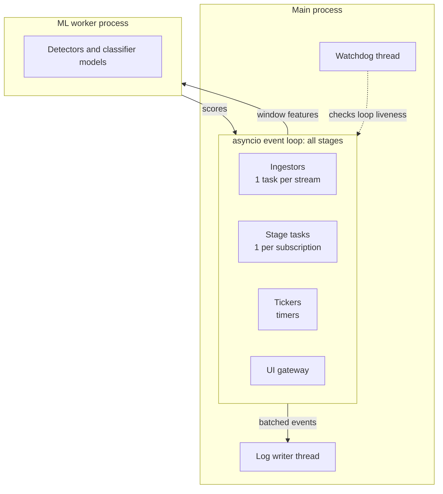
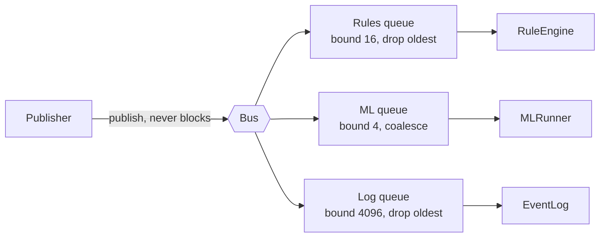

# Concurrency and backpressure

!!! proposed "Proposed"
    The instructor explicitly required this topic, so it deserves its own subsection in the Design Document. The approach must be validated by the event-bus spike (W2–W4) before it is written there.

## Execution model



| Unit | Runs | Why |
|---|---|---|
| Every stage | One asyncio task per subscription, in one event loop | Stages are mostly small and CPU-light; a single thread means no locks and no data races |
| ML inference | A separate process via `ProcessPoolExecutor(max_workers=1)` | Scoring must not freeze the loop; a crash in it stays contained |
| Log writing | Its own thread, batched | Disk latency stays out of the loop |
| Watchdog | Its own OS thread | Only something outside the loop can notice that the loop itself has frozen |

**Golden rule:** nothing inside the loop may block for more than a few milliseconds. CPU-heavy work belongs in the worker. A CI test runs with `asyncio`'s debug mode to flag slow callbacks.

## Bounded queues

Each subscription owns one bounded queue. `publish()` is a plain synchronous call that places an event in each subscriber's queue. It never awaits, so **a slow consumer cannot slow its publisher, and no deadlock is possible**.



## Overload policies

FR46 names two policies, and the choice for each queue is part of the design.

| Policy | Behaviour when full | Use for | Example |
|---|---|---|---|
| `DROP_OLDEST` | Evict the oldest item | Streams where newer data supersedes older data | Telemetry, rule windows |
| `COALESCE` | Replace the queued item having the same key, so the consumer sees only the newest per key | Latest-state data | Evidence by (component, check); ML windows |

`DataDiscarded` is aggregated per queue and emitted at most once per second. Each report states how much data was affected, which feeds F17 (FR47).

!!! warning "What is not lost"
    Coalescing fused evidence loses nothing that matters to the state machine, since only the newest value counts. But the engine's timers must use the *source time* of the newest event, not the arrival count, so a dropped event does not shorten or lengthen T<sub>conf</sub>.

## Time

Three clocks exist, and mixing them up is the most likely source of subtle bugs.

| Clock | Meaning | Used for |
|---|---|---|
| Source time | The robot's timestamp on a sample | Ordering, windows, all state-machine timers |
| Receive time | When the sample reached the system | Delay, staleness, NFR1 |
| Wall or virtual time | `Clock.now()` | Ticks, heartbeats, timeouts of operations |

## Two run modes

| | `realtime` | `deterministic` |
|---|---|---|
| Clock | `WallClock` | `VirtualClock`, advanced by the source |
| ML | Worker process | Inline, in the loop |
| Overload | Can occur, drops depend on timing | Never drops: loop runs until quiescent before advancing |
| Replay speed | 1× to 5× | As fast as the CPU allows |
| Used for | NFR1, NFR2, NFR3, NFR6, demos, UI | Evaluation campaigns, NFR15, unit and scenario tests |

Reproducibility (NFR15) and timing behaviour can't both be measured in one run, because real-time drops depend on the machine. The design therefore separates them. The Evaluator reports detection delay in event time from deterministic runs, and timing requirements are tested separately in real-time runs.

## Failure isolation

A `StageRunner` wraps each stage's handler:

```python
async def run(self) -> None:
    while True:
        event = await self.queue.get_or_timeout(self.heartbeat_period)
        self.bus.publish(Heartbeat(stage=self.name, processed=self.count))
        if event is None:
            continue
        try:
            self.handler(event)
            self.count += 1
        except Exception as exc:          # NFR5: contain, report, keep going
            self.bus.publish(StageFailed(stage=self.name, error=repr(exc)))
```

`RuleEngine` also isolates individual rules, and disables a rule after `max_failures` consecutive exceptions (default 3). Its `StageFailed` event becomes evidence against the pipeline component, so the operator sees that coverage has shrunk.

Note that `asyncio.TaskGroup` is **not** used as the top-level supervisor, because its default behaviour cancels every sibling when one task fails. This is exactly what NFR5 forbids.

## Throughput sanity check

Eight low-dimensional streams at 30 Hz, at 5×, give 1,200 samples per second. With one `WindowReady` per 40 ms of wall time, rules run 25 times per second over 43 joints. This should be well within the capacity of a single asyncio loop if per-event work stays small, but **this is an estimate**, and the spike must measure it. If the loop cannot keep up, the fallback is to batch `TelemetryReceived` per frame, not to add threads.

**Next:** [Styles and patterns](patterns.md)
