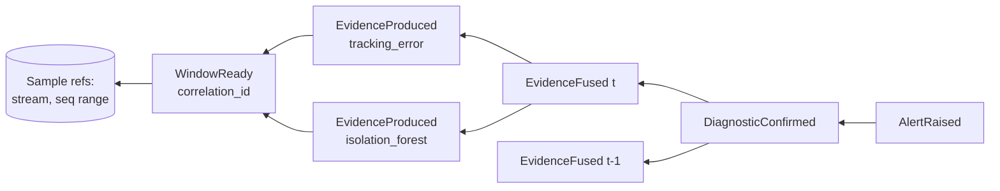

# Event catalogue

!!! proposed "Proposed, built on a baseline"
    `TelemetryReceived`, `WindowReady`, `AnomalyDetected`, `FaultClassified`, `FaultLocalized`, `DiagnosticConfirmed`, `AlertRaised` and `SymptomReported` are baseline (proposal §5). The rest are added here because the requirements need them.

Events are immutable, and they are the only way components communicate. Each topic carries one event type.

## Common envelope

Every event carries the metadata the proposal requires.

| Field | Type | Meaning |
|---|---|---|
| `event_id` | `EventId` | Unique ID |
| `source_time` | `TimeNs` | Robot time of the newest underlying data |
| `receive_time` | `TimeNs` | When that data reached the system |
| `publish_time` | `TimeNs` | When this event was published |
| `producer` | `str` | Producing component |
| `correlation_id` | `CorrelationId` | The sample set behind this event ([see below](#correlation-and-causes)) |
| `causes` | `tuple[EventId, ...]` | The events this one was derived from |

## Topics

| Event | Producer | Consumers | Key payload | Rate at 1× | Overflow policy |
|---|---|---|---|---|---|
| `TelemetryReceived` | `StreamIngestor` | Health tracker, aligner, sample store | `sample` | ≈30 Hz per stream | Drop oldest |
| `WindowReady` | `Windower` | Rule engine, ML runner | `window` | 5 Hz | Coalesce (keep newest) for ML; drop oldest for rules |
| `EpisodeBoundary` | `ReplayAdapter`, through ingestion | Windower, rules, engine | `episode_id` | Rare | Never drops in practice |
| `EvidenceProduced` | Rules, ML, health tracker, health monitor, orchestrator | Fusion, log | `evidence` | ≈ 5 Hz × checks × components | Coalesce by (component, check) |
| `EvidenceFused` | Fusion | Engine, log | `component`, `score`, `rule_score`, `ml_score`, `coverage` | 5 Hz per active component | Coalesce by component |
| `EvidenceConflictDetected` | Fusion | UI, log | `component`, `rule_score`, `ml_score`, `evidence_ids` | Rare | Control |
| `AnomalyDetected` | Fusion | Classifier | `component`, `score`, `evidence_ids`, `suggestions` | Only above θanomaly | Coalesce by component |
| `FaultClassified` | Classifier | Localizer | `component`, `hypotheses` | As anomaly | Coalesce by component |
| `FaultLocalized` | Localizer | Engine, alert manager, log | `component`, `region`, `hypotheses`, `layer` | As anomaly | Coalesce by component |
| `DiagnosticStateChanged` | Engine | UI, alert manager, log | `component`, `old`, `new`, `transition` | Rare | Control |
| `DiagnosticConfirmed` | Engine | Alert manager, log | `diagnosis_id`, `component`, `hypotheses`, `evidence_ids` | Rare | Control |
| `AlertRaised` | Alert manager | UI, log | `alert_id`, `diagnosis_id`, `component`, `region`, `hypotheses`, `confirmed_at` | Rare | Control |
| `AlertUpdated` | Alert manager | UI, log | `alert_id`, `hypotheses`, `evidence_present` | Rare | Control |
| `AcknowledgeRequested` | UI gateway | Engine, log | `alert_id`, `operator` | Rare | Control |
| `AlertAcknowledged` | Alert manager | UI, log | `alert_id`, `acknowledged_at` | Rare | Control |
| `StreamHealthChanged` | Health tracker | Windower, rules, UI, log | `stream`, `old`, `new` | Rare | Control |
| `DataDiscarded` | Bus, reorder buffer | Health monitor, log | `where`, `count`, `reason` | At most 1 Hz per queue, aggregated | Control |
| `Heartbeat` | Stage runner | Health monitor | `stage`, `processed` | 1 Hz per stage | Coalesce by stage |
| `StageFailed` | Stage runner | Health monitor, log | `stage`, `check`, `error` | Rare | Control |
| `HealthSnapshot` | Health monitor | UI, log | Queues, drops, streams, stages | 1 Hz | Coalesce |
| `SymptomReported` | UI gateway | Orchestrator, log | `report_id`, `text` | Rare | Control |
| `GuidedDiagnosisCompleted` | Orchestrator | UI, log | `report_id`, `hypotheses`, `skill_runs`, `justification`, `planner` | Rare | Control |
| `SessionStarted`, `SessionEnded` | Session controller | All, log | `session_id`, `config_hash`, `mode` | Rare | Control |

"Control" is a queue with a generous bound and drop-oldest policy. In correct operation it never fills, and if it does, this is reported as a critical `DataDiscarded`, since FR46 requires every queue to be bounded.

## Correlation and causes

One alert rests on many windows and many samples, so a single ID cannot say everything. The design uses two mechanisms.

- **`correlation_id` identifies a sample set.** It is assigned when a window is built and stays with the evidence computed from it (FR19). The window records exact sample references: `(stream, first_seq, last_seq)`.
- **`causes` links events.** Each derived event lists the events it came from, which forms a graph that `TraceQuery` walks.

`DiagnosticConfirmed` lists all fused evidence since the component entered SUSPECTED, up to a limit `max_trail` (default 300), keeping the bound of NFR6. Beyond the limit the oldest are summarized by count. NFR14 is verified by an automated walk of this graph over a campaign's logs.

**Next:** [Runtime view](runtime.md)
