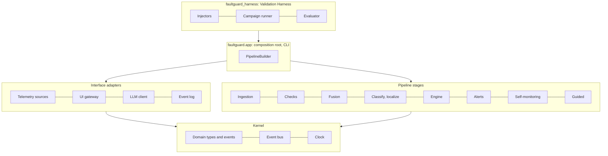

# Architecture

!!! proposed "Proposed, built on a baseline"
    The event-driven style, the stages, the patterns and the main events are **baseline** (proposal §4–5). How they fit together in detail, the added events, and the technology are **proposed** here as input to the Design Document.

## Architectural drivers

Each driver comes from a requirement and forces a specific structural decision.

| Driver | Requirements | Structural decision |
|---|---|---|
| Add faults and checks without touching existing code | NFR10–NFR13, G4 | Stable interfaces; implementations loaded from configuration; no central `switch` on fault type anywhere |
| Keep going on imperfect telemetry | FR5–FR8, NFR4 | Independent ingestion per stream; explicit "missing"; health as first-class data |
| Survive overload | FR46–FR47, NFR3 | Bounded queue per subscriber, and a publish that never blocks |
| One failure must not spread | NFR5, S9 | Supervised stages; no stage depends on another stage's availability |
| Trace any alert back to samples | FR19, FR42, NFR14 | Every event records its causes; append-only event log |
| Reproducible evaluation | NFR15, FR16 | Injected clock and seeds; deterministic run mode |
| Honest evaluation | FR15 | Harness and system in separate packages, with an enforced one-way dependency |
| Cannot actuate | NFR17, FR52 | Read-only interfaces with no send operation to misuse |

## Structure in layers

The arrows are import dependencies and they only point downward. The kernel depends on nothing else. `faultguard` never imports `faultguard_harness`. An `import-linter` contract in CI [enforces both](../design/layout.md#dependency-rules).

## Principles

1. **Stages know events, not each other.** A stage subscribes to topics and publishes to topics. Replacing or removing one needs no change to the others.
2. **Publishing never blocks.** A slow consumer harms only itself: its own queue fills and its own policy applies.
3. **State lives in exactly one owner.** Each mutable structure belongs to one stage. Everything else sees a copy, as an immutable event.
4. **Missing is a value.** A check that lacks input says so, which differs from reporting a low score. Absence of data can never look like health.
5. **Decide in one place.** Only the diagnostic engine changes diagnostic states; only the alert manager raises alerts.
6. **Time is injected.** No stage reads the system clock directly, so timing logic can be tested exactly.

**Next:** [Component view](components.md)
