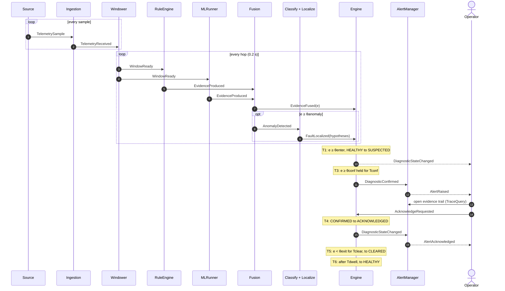
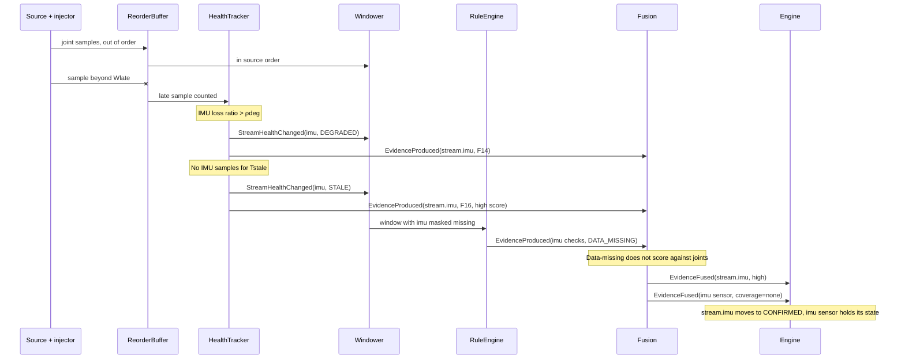
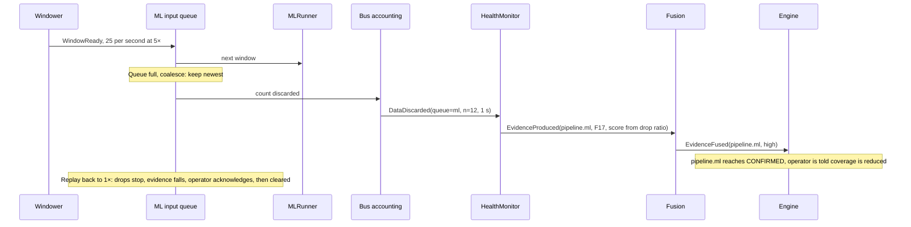
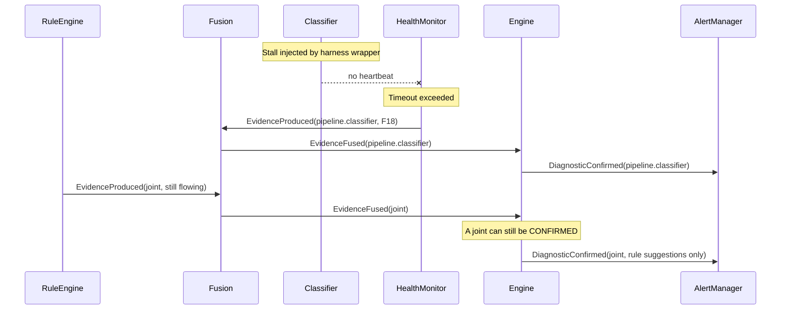
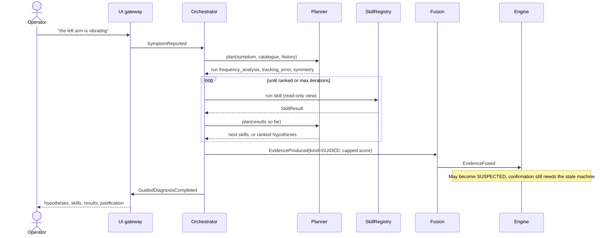
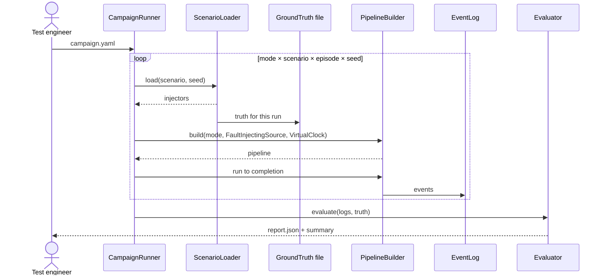

---
hide:
  - toc
---

# Runtime view

!!! proposed "Proposed"
    Refines the RASD's black-box sequence diagrams into internal components. Bus hops are shown as direct messages for readability.

## Detect, confirm, acknowledge, clear (S2)

## Latency budget for NFR1

NFR1 allows 2 s from the receive time of the last contributing sample to `DiagnosticConfirmed`, at 1×. Tconf is not part of this budget: the last contributing sample is the one that completes it.

| Step | Default | Worst case at 1× |
|---|---|---|
| Reorder buffer holds sample until the watermark passes | Wlate = 100 ms | 100 ms |
| Waiting for the next window hop | Hop = 200 ms | 200 ms |
| Alignment across streams | Waits on the slowest active stream up to Wlate | 100 ms |
| Rule evaluation | Inline | < 20 ms (target) |
| ML evaluation including queueing | One window in flight, one queued | < 400 ms (target) |
| Fusion, engine, bus hops | | < 20 ms (target) |
| **Total** | | **≈ 840 ms** |

The margin of over a second is deliberate. It allows for a loaded laptop, and it also means the window parameters can grow during tuning. These targets must be measured in the event-bus spike; they are not measurements yet.

## Degraded link (S4)

## Overload (S5)

## Stalled classifier (S9)

## Guided diagnosis (S12)

## Evaluation campaign (S11)

**Next:** [Concurrency and backpressure](concurrency.md)
