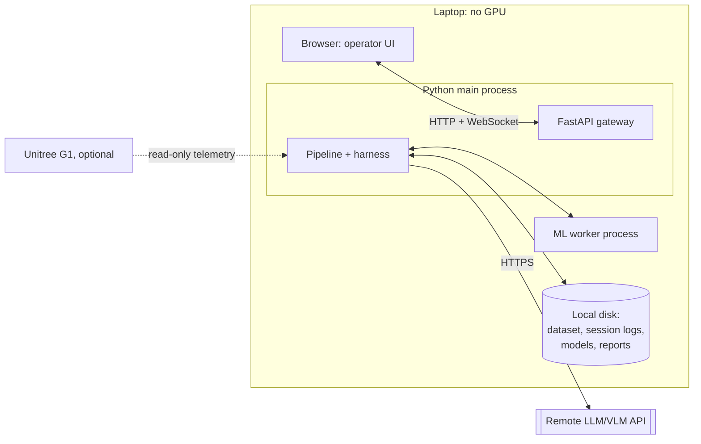

# Technology and deployment

!!! proposed "Proposed: the team must decide"
    The project plan lists the stack as an open point (Python asyncio or ROS 2). This page recommends **Python asyncio**; the reasoning is in [ADR-001](../reference/adrs.md#adr-001-python-asyncio-instead-of-ros-2). The architecture would survive a change: only the bus, the runner and the composition root depend on it.

## Stack

| Concern | Choice | Reason |
|---|---|---|
| Language | Python ≥ 3.11 | ML libraries, dataset loader, team familiarity |
| Concurrency | `asyncio`, one worker process | [Concurrency](concurrency.md) |
| Numeric | NumPy, SciPy | Windows, FFT, filtering |
| ML | scikit-learn | Isolation Forest and Random Forest named in the proposal; no GPU needed (NFR20) |
| Configuration | YAML + Pydantic v2 | Validated, with clear errors for the test engineer |
| UI backend | FastAPI, WebSocket | Server push meets NFR2 |
| UI frontend | Static HTML + vanilla JS | Simple, with no build step; the UI is not the focus of the project |
| Event log | JSON Lines via `orjson` | Append-only, human-readable, easy to diff |
| Sample store | Parquet per session | Compact, columnar, addressable |
| Tests | `pytest`, `pytest-asyncio`, `hypothesis` | Property tests suit the state machine and reorder buffer |
| Quality | `ruff`, `mypy`, `import-linter` | Dependency rules become CI failures |
| CI | GitHub Actions | Already part of the course workflow |
| Packaging | `pyproject.toml` with `uv` or `pip` | Simple installation for D3 |

## Deployment view

The prototype runs on one laptop.



NFR20 still needs a concrete machine specification, which should be the weakest laptop in the team. See [Open decisions](../project/decisions.md).

## Command-line interface

```bash
faultguard run      --config configs/session.yaml                # interactive, with UI
faultguard-harness  run      --scenario scenarios/s2.yaml        # one injected session
faultguard-harness  campaign --campaign campaigns/full.yaml      # batch, writes a report
faultguard-harness  train    --config configs/train.yaml         # fit detectors and classifier
faultguard-harness  calibrate --config configs/calibrate.yaml    # per-joint thresholds
```

**Next section:** [Low-level design](../design/index.md)
