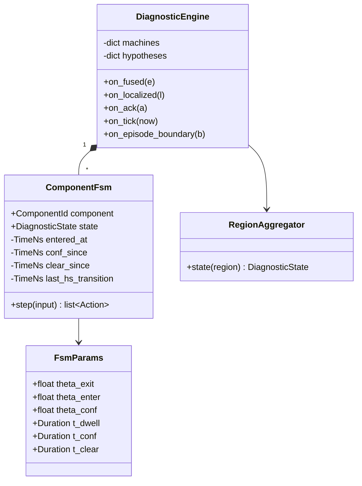

# Diagnostic engine

!!! proposed "Proposed"
    Implements FR29–FR37. Transitions T1–T7 are the baseline from [state machines](../requirements/state-machines.md). The additions are marked.

## Structure



`ComponentFsm.step` is a **pure state transition**: all time and evidence arrive as input, and the output is a list of actions. It has no I/O, so it can be tested exhaustively without a bus.

## Transition table

```python
@dataclass(frozen=True)
class FsmInput:
    now: TimeNs             # source time of the newest evidence
    e: float
    coverage: Coverage      # FULL, PARTIAL or NONE
    ack: bool = False

TRANSITIONS = (
  # id   from          guard                                             to            action
  ("T1", HEALTHY,      lambda m,i: i.e >= m.p.theta_enter and m.rearmed(i.now), SUSPECTED,    NOTIFY),
  ("T2", SUSPECTED,    lambda m,i: i.e <  m.p.theta_exit  and m.dwelled(i.now), HEALTHY,      NOTIFY),
  ("T3", SUSPECTED,    lambda m,i: m.conf_held(i),                         CONFIRMED,    CONFIRM),
  ("T4", CONFIRMED,    lambda m,i: i.ack,                                  ACKNOWLEDGED, RECORD_ACK),
  ("T5", ACKNOWLEDGED, lambda m,i: m.clear_held(i),                        CLEARED,      LOG_RESOLUTION),
  ("T6", CLEARED,      lambda m,i: i.e <  m.p.theta_enter and m.dwelled(i.now), HEALTHY,      NOTIFY),
  ("T7", CLEARED,      lambda m,i: i.e >= m.p.theta_enter,                 SUSPECTED,    NOTIFY_RECURRENT),
)
```

The table's rows correspond one to one to RASD Table 3.1. A test checks this correspondence, and a test name such as `test_T3_...` ties it back to the requirement.

### Timers

```python
def update_timers(self, i: FsmInput) -> None:
    # Timers run on source time, so a dropped or coalesced event can't change them.
    if i.e >= self.p.theta_conf:
        self.conf_since = self.conf_since or i.now
    else:
        self.conf_since = None
    if i.e < self.p.theta_exit and i.coverage is not Coverage.NONE:
        self.clear_since = self.clear_since or i.now
    else:
        self.clear_since = None
```

### Addition: re-arm guard for NFR7

T1 in the RASD has no time guard, so T2 followed immediately by T1 would break NFR7's minimum spacing. The `rearmed` guard resolves this.

```python
def rearmed(self, now: TimeNs) -> bool:
    return self.last_hs_transition is None or now - self.last_hs_transition >= self.p.t_dwell
```

The first detection stays immediate: the guard only applies right after returning to HEALTHY. The cost is that a real fault right after recovery is delayed by at most T<sub>dwell</sub>. This needs [team approval](../project/rasd-review.md#b2-the-state-machine-does-not-guarantee-nfr7), and T1's guard in the RASD should be updated to match.

### Addition: missing evidence

If `coverage = NONE`:

- T2 and T5 can't fire, and the clear timer resets. **Not knowing is not recovery.**
- T1 and T3 can't fire either, as *e* is not meaningful.
- The confirm timer pauses. It does not reset, since one lost window should not restart confirmation. If nothing arrives for T<sub>stale-evidence</sub> (default 3 s), it resets.
- The UI shows the component's state with a "no coverage" marker, keeping any loss of coverage visible (G3).

### Latching

CONFIRMED has only one exit, T4, so it stays latched even if evidence disappears (FR33). In that case the engine publishes a `DiagnosticStateChanged` with `evidence_present = false`, which the UI shows as "evidence no longer present". The latching policy is awaiting confirmation; see [Open decisions](../project/decisions.md).

## Per-class parameters

FR36: thresholds are configured per class of component.

```yaml
fsm:
  defaults:  {theta_exit: 0.3, theta_enter: 0.5, theta_conf: 0.7, t_dwell_s: 2.0, t_conf_s: 1.0, t_clear_s: 3.0}
  JOINT:     {}                       # inherits the defaults
  STREAM:    {t_conf_s: 0.5}          # communication faults are unambiguous
  PIPELINE:  {t_conf_s: 0.0, t_clear_s: 5.0}
  SENSOR:    {t_conf_s: 1.5}
```

Configuration validation enforces θ<sub>exit</sub> < θ<sub>enter</sub> ≤ θ<sub>conf</sub> at start-up, so a bad file can't cause a silent failure.

## Body regions

The state of a region is the most severe state among its joints and sensors (FR37). Proposed severity order:

**CONFIRMED** > **ACKNOWLEDGED** > **SUSPECTED** > **CLEARED** > **HEALTHY**

An unacknowledged confirmed fault outranks everything because it needs action. An acknowledged one ranks above a merely suspected one, since it is an established fault.

## Hand-offs

- On T3, the engine publishes `DiagnosticConfirmed` with the current hypotheses (or provisional ones), and the contributing evidence IDs.
- The operator's `AcknowledgeRequested` gives `FsmInput(ack=True)`. Requests for a component not in CONFIRMED are logged and ignored, so that a double click is harmless.
- `on_tick` runs every 200 ms so that time-based guards fire even without new evidence.

## Testing

Pure state logic allows a very thorough test suite, and this is worth doing since this is the heart of G2.

| Test | Verifies |
|---|---|
| Each T*n* has its positive and negative guard cases | FR29–FR35 |
| Property: for any evidence sequence, θ-consistent, consecutive HEALTHY↔SUSPECTED transitions are ≥ T<sub>dwell</sub> apart | NFR7 |
| Property: no path reaches CONFIRMED without ≥ T<sub>conf</sub> of e ≥ θ<sub>conf</sub> | FR31 |
| Property: no path leaves CONFIRMED without an ack | FR33, FR34 |
| Property: `coverage = NONE` never leads to CLEARED or HEALTHY | FR28, G3 |
| Scripted borderline sequence from S6 | NFR7, S6 |
| Bad threshold ordering rejected at load | FR36 |
| Region state equals the maximum severity of its members | FR37 |
| Timers unaffected when evidence events are coalesced | Backpressure |

**Next:** [Alerts and event log](alerts-log.md)
