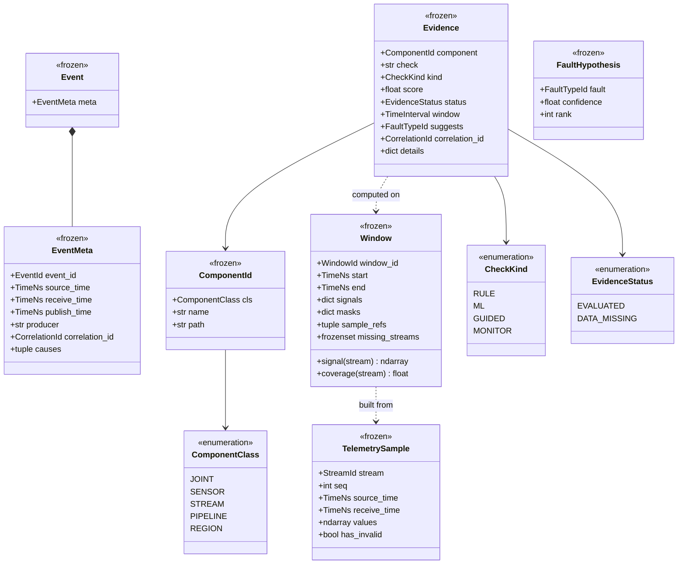

# Domain types

!!! proposed "Proposed"
    Implements the [domain model](../requirements/domain-model.md) and [event catalogue](../architecture/events.md).

All domain types are frozen dataclasses. Numeric arrays are made read-only on construction, since a frozen dataclass does not protect an array's contents, and "immutable events" is an architectural constraint.

## Class overview



## Core definitions

```python
TimeNs = NewType("TimeNs", int)                # integer nanoseconds: no float drift
EventId = NewType("EventId", str)              # uuid7: unique, time-sortable
CorrelationId = NewType("CorrelationId", str)  # "win-<session>-<n>"

@dataclass(frozen=True, slots=True)
class ComponentId:
    cls: ComponentClass
    name: str          # "joint.left_elbow", "stream.imu", "pipeline.classifier"

@dataclass(frozen=True, slots=True)
class TelemetrySample:
    stream: StreamId
    seq: int
    source_time: TimeNs
    receive_time: TimeNs
    values: np.ndarray  # read-only; NaN is allowed and meaningful (FR8)

@dataclass(frozen=True, slots=True)
class Evidence:
    component: ComponentId
    check: str
    kind: CheckKind
    score: float                      # 0..1; meaningful only when status is EVALUATED
    status: EvidenceStatus
    window: TimeInterval
    correlation_id: CorrelationId
    suggests: FaultTypeId | None = None
    details: Mapping[str, float] = field(default_factory=dict)
```

`Evidence.status` is what makes principle 4, "missing is a value", enforceable. `score=0.0, status=DATA_MISSING` can't be mistaken for "looked and found nothing".

## Streams

| `StreamId` | Dim | Source field | Fault coverage |
|---|---|---|---|
| `joint.arm` | 14 | `states.arm_state` | F1–F5, F9–F12 |
| `joint.leg` | 15 | `states.leg_state` | F1–F5 |
| `joint.hand` | 14 | `states.hand_state` | F1–F5, F9–F12 |
| `cmd.arm` | 14 | `actions.sol_q` | Command side of F9–F12 |
| `cmd.hand` | 14 | `actions.left_angles`, `right_angles` | Command side of F9–F12 |
| `torque.arm` | 14 | `actions.tau_ff` | Informational |
| `imu` | 13 | `states.imu.*` | F4–F7 |
| `odometry` | 13 | `states.odometry.*` | F4, cross-check |
| `pressure` | Varies | `states.hand_pressure_state` | F8 |
| `camera.rgb`, `camera.depth`, `lidar` | Reference | File paths | Skills only |

Perception streams travel as file references and never enter the pipeline as arrays: they are large, and only the guided-diagnosis skills use them.

## Robot model

`RobotModel` is loaded from `configs/robot_g1.yaml`. It is the single place holding joint names, array indices, regions, limits, and left/right pairs. Every component uses it instead of hard-coding an index.

```yaml
model: unitree_g1
joints:
  - {id: left_elbow, stream: joint.arm, index: 3, region: left_arm,
     command: {stream: cmd.arm, index: 3}, pair: right_elbow,
     lower: null, upper: null}   # limits from the manufacturer's data (DA5)
  - {id: left_knee, stream: joint.leg, index: 3, region: left_leg,
     command: null, pair: right_knee,    # no command recorded on G1
     lower: null, upper: null}
```

A check that needs a command tests `joint.command is not None`, so missing leg commands are handled in data rather than by special cases in code.

**Next:** [Event bus](event-bus.md)
