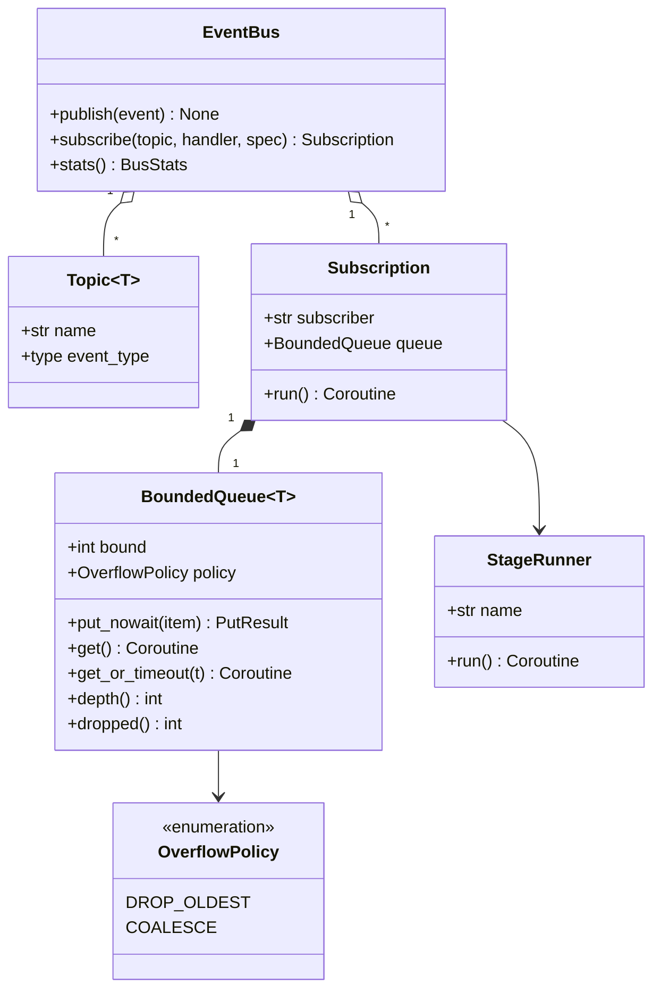

# Event bus

!!! proposed "Proposed"
    Implements FR46 and FR47 and supports NFR3. The event-bus spike in W2–W4 should build exactly this, and measure it.



## Interface

```python
class EventBus:
    def publish(self, event: Event) -> None:
        """Synchronous, never blocks, never raises. Stamps publish_time."""

    def subscribe(
        self,
        topic: Topic[T],
        handler: Callable[[T], None],
        *,
        subscriber: str,
        bound: int,
        policy: OverflowPolicy,
        coalesce_key: Callable[[T], Hashable] | None = None,
    ) -> Subscription: ...
```

## Algorithm: bounded queue

```python
def put_nowait(self, item) -> PutResult:
    if self.policy is COALESCE:
        key = self.coalesce_key(item)
        if key in self._by_key:              # same key already queued
            self._by_key[key] = item         # keep the newest, keep its position
            self._dropped += 1
            return PutResult.COALESCED
    if len(self._order) >= self.bound:       # full: evict oldest
        oldest = self._order.popleft()
        self._by_key.pop(oldest, None)
        self._dropped += 1
    # insert, wake any waiting consumer
```

Both operations are O(1), and the structure never exceeds `bound` by construction. A property test checks this: *for any sequence of puts and gets, depth ≤ bound, and every put item is delivered, dropped or coalesced, exactly once*.

## Default subscriptions

| Subscriber | Topic | Bound | Policy | Coalesce key |
|---|---|---|---|---|
| Aligner | `TelemetryReceived` | 256 | Drop oldest | |
| Health tracker | `TelemetryReceived` | 256 | Drop oldest | |
| Sample store | `TelemetryReceived` | 4096 | Drop oldest | |
| Rule engine | `WindowReady` | 16 | Drop oldest | |
| ML runner | `WindowReady` | 4 | Coalesce | Region |
| Fusion | `EvidenceProduced` | 1024 | Coalesce | (component, check) |
| Engine | `EvidenceFused` | 512 | Coalesce | Component |
| Classifier | `AnomalyDetected` | 64 | Coalesce | Component |
| Localizer | `FaultClassified` | 64 | Coalesce | Component |
| Log | All | 8192 | Drop oldest | |
| Control consumers | Control topics | 256 | Drop oldest | |

## Testing

| Test | Verifies |
|---|---|
| Property: bound never exceeded under random put and get sequences | FR46 |
| Property: delivered + dropped + coalesced = published | FR47 |
| Slow consumer does not delay a fast consumer on the same topic | NFR3, NFR5 |
| Consumer raising an exception does not stop others | NFR5 |
| `publish` called from a handler does not deadlock | Principle 2 |
| Benchmark: sustained events per second, added latency percentiles | Spike output |

**Next:** [Sources and ingestion](ingestion.md)
