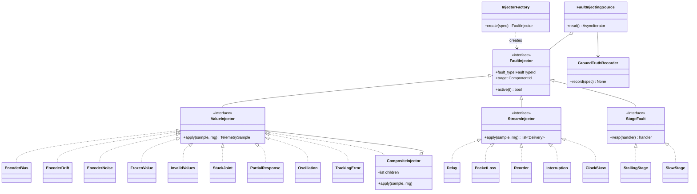
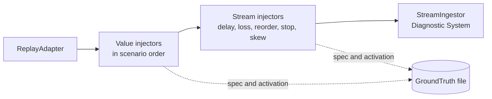

# Fault injection

!!! proposed "Proposed"
    Implements FR11–FR16 and the injection half of NFR10. The proposal fixes the factory and composition ideas; the rest is proposed. This code belongs to `faultguard_harness`.

## Classes



## Injection pipeline

Value injectors run first, then stream injectors. A packet that is dropped therefore carries no value fault, and delayed samples still hold corrupted values. This matches a fault on the robot followed by a fault on the link.



## Injector specifications

*t* is time since onset; *q* is the original value; *r* is the original command. Parameters are read from configuration.

| Fault | Class | Behaviour | Main parameters |
|---|---|---|---|
| F1 Encoder bias | `EncoderBias` | q + b | `offset_rad` |
| F2 Encoder drift | `EncoderDrift` | q + k·t | `rate_rad_s` |
| F3 Encoder noise | `EncoderNoise` | q + N(0, σ²) | `sigma_rad` |
| F4 Frozen value | `FrozenValue` | q(onset), held | |
| F5 Missing/NaN | `InvalidValues` | NaN with probability p | `prob` |
| F6 IMU bias | `EncoderBias` on `imu` | a + b | `field`, `offset` |
| F7 IMU drift | `EncoderDrift` on `imu` | a + k·t | `field`, `rate` |
| F8 Pressure dropout | `ValueDropout` | 0 or NaN | `mode` |
| F9 Stuck joint | `StuckJoint` | q(onset), held while r moves | |
| F10 Partial response | `PartialResponse` | Output of a first-order lag on attenuated command | `gain`, `tau_s` |
| F11 Oscillation | `Oscillation` | q + A·sin(2πft) | `amp_rad`, `freq_hz` |
| F12 Tracking error | `TrackingError` | q + e, with e persistent and ramped in | `error_rad`, `ramp_s` |
| F13 Delay | `Delay` | Holds a sample for d ± jitter | `delay_ms` |
| F14 Packet loss | `PacketLoss` | Drops with probability p | `prob` |
| F15 Out of order | `Reorder` | Swaps in a bounded sliding buffer | `depth` |
| F16 Interruption | `Interruption` | Drops all, for the duration | |
| F17 Overload | `SlowStage`, or replay rate | Adds a delay per event | `delay_ms` |
| F18 Stall | `StallingStage` | Stops consuming and beating | `after_s` |
| F19 Clock skew | `ClockSkew` | Shifts `source_time` of one stream | `offset_ms`, `rate_ppm` |

!!! note "Modelling notes"
    F9–F12 alter the *measurement* stream using the recorded command, since a replay cannot change what the real robot did. This is the point of DA6. F4 and F9 give identical output on arms, which is what makes S3's ambiguity real. F19 is listed at "pipeline runtime" in the RASD but is more simply injected by the source wrapper, since it concerns source timestamps.

## Scenario file

Implements FR11. Scenario names follow the RASD, so a run can be traced back to the scenario it verifies.

```yaml
name: s8_drift_plus_loss
seed: 42
description: Simultaneous encoder drift and packet loss (RASD S8)
episodes: {task: push_a_button, count: 1}
faults:
  - id: drift_left_shoulder
    class: faultguard_harness.injectors.values:EncoderDrift
    fault_type: F2
    target: joint.left_shoulder_pitch
    onset_s: 3.0
    duration_s: 8.0
    params: {rate_rad_s: 0.05}
  - id: loss_joint_stream
    class: faultguard_harness.injectors.streams:PacketLoss
    fault_type: F14
    target: stream.joint.arm
    onset_s: 5.0
    duration_s: 4.0
    params: {prob: 0.2}
```

## Keeping the ground truth away from the system

FR15 is enforced in three independent ways:

1. **Dependency.** `faultguard` cannot import `faultguard_harness` (import-linter).
2. **No shared channel.** `GroundTruthRecorder` writes directly to `truth.json` in the run directory. It does not publish on the bus, and the file's path never reaches `PipelineBuilder`.
3. **Metadata hygiene.** Injected samples look like any other. There is no `is_injected` flag, and a test scans an injected run's event log for scenario names and fault IDs from the truth file.

## Randomness

Each injector gets its own generator, seeded from `(scenario.seed, fault.id)`. Adding or reordering faults therefore does not change the random sequence of another fault (FR16).

## Testing

| Test | Verifies |
|---|---|
| Each injector, on a synthetic signal: exact expected output, inactive outside its interval | F1–F19 |
| Two injectors on one target: composition order is defined | FR14 |
| Same seed gives identical output; adding an unrelated fault leaves it unchanged | FR16 |
| Log scan finds no ground-truth marker | FR15 |
| A scenario referring to an unknown class fails at load, with a clear message | FR12 |

**Next:** [Rules](rules.md)
