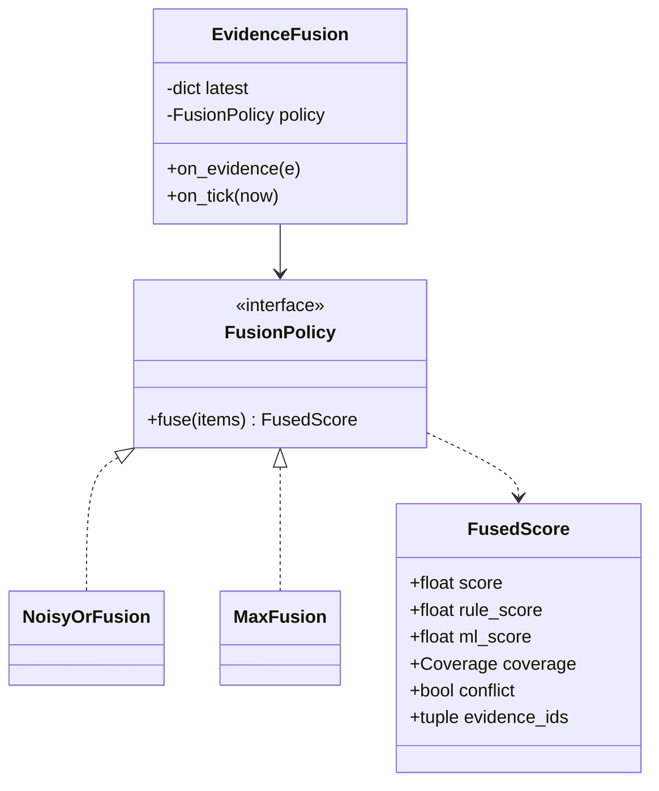

# Evidence fusion

!!! proposed "Proposed"
    Implements FR21 and FR22. The proposal requires a Strategy interface and explicit handling of disagreement; the formula is proposed.

## Responsibility

For each component, `EvidenceFusion` keeps the latest evidence per check, and on each hop produces one fused score. It is the only place where different checks' opinions are combined.



## Algorithm

On each hop, for each component with live evidence:

1. **Expire.** Drop evidence older than its TTL (default 2 hops × check period, in source time).
2. **Split.** Separate `EVALUATED` from `DATA_MISSING`.
3. **Score per family.** For each family of checks, *rule*, *ML*, *monitor* and *guided*, combine with noisy-OR:

    ```text
    family_score = 1 − ∏ (1 − w_c · s_c)
    ```

4. **Cap guided evidence.** See below.
5. **Combine.** Combine the family scores with noisy-OR for the overall score *e(t)*.
6. **Coverage.** Set `coverage` to `FULL`, `PARTIAL` or `NONE`, according to how many required checks were evaluated.
7. **Conflict.** If both rule and ML evaluated and `|rule_score − ml_score| > margin`, publish `EvidenceConflictDetected` once per conflict period (FR22). Both evidence lists are kept.
8. **Publish.** `EvidenceFused` always; `AnomalyDetected` if *e(t)* ≥ θ<sub>anomaly</sub> (default 0.3).

Noisy-OR suits the idea of independent witnesses: one strong witness is enough, and several weak ones add up. The risk is that correlated checks overstate the case: `tracking_error` and `cmd_meas_inconsistency` often fire together. Weights *w<sub>c</sub>* in configuration offset this, and `MaxFusion` is available for comparison in the evaluation.

## Coverage and missing evidence

`coverage = NONE` means nothing could be evaluated. The engine uses it to **hold** its state rather than treat the absence of evidence as recovery; see [Diagnostic engine](diagnostic-engine.md#addition-missing-evidence). This is what stops a dropped stream from clearing a real fault, and it supports S4 and FR28.

## Conflict policy

Fusion never resolves a conflict silently. The score is still computed, since the state machine needs an input, but:

- `EvidenceConflictDetected` goes to the log and the UI, naming both sides.
- The UI shows a dedicated indicator on that component.
- The conflict stays visible, whatever the state machine does next.

In S7, ML says anomaly and rules say nothing. The fused score reflects the ML evidence, weighted lower by default, and the conflict is recorded.

## Guided evidence is capped

DA8 says LLM answers are untrusted. FR53 lets them in only as evidence, and S12 expects SUSPECTED but no direct confirmation. Without a cap, a persistent confident LLM answer could confirm a fault on its own, which S12 explicitly rules out.

```text
guided contribution ≤ guided_cap,   with θ_enter ≤ guided_cap < θ_conf
```

The default is `guided_cap = 0.6`. Guided evidence can raise a component to SUSPECTED on its own, but reaching θ<sub>conf</sub> takes support from rules, ML or monitors. Guided evidence also expires, with a longer TTL (default 10 s), because it is a one-off assessment.

## Testing

| Test | Verifies |
|---|---|
| Table-driven formula tests, including empty input and weight 0 | FR21 |
| Policy switched through configuration | FR21, NFR11 |
| Rule 0.0, ML 0.9 gives a conflict, and both evidence IDs are kept | FR22 |
| No conflict when ML is missing or in rules-only mode | FR22 |
| Guided evidence alone never reaches θ<sub>conf</sub>, property-tested | FR53, DA8 |
| Evidence expires by source time, with TTL | Timing |
| All-missing evidence gives `coverage = NONE` | FR28 |

**Next:** [Classification and localization](classify-localize.md)
