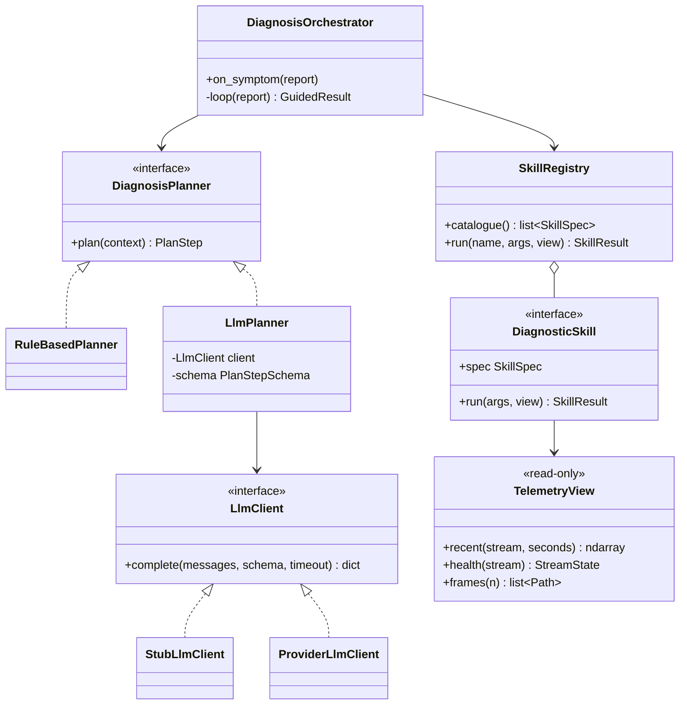

# Guided diagnosis

!!! proposed "Proposed"
    Implements FR49–FR56, the **secondary objective**, and the first feature to cut if time runs short. The orchestrator, skills and read-only constraint are baseline. The deterministic planner should be built first, since the LLM may be cut.

## Structure



## The loop

```python
async def loop(self, report: SymptomReport) -> GuidedResult:
    ctx = PlanContext(symptom=report.text, catalogue=self.registry.catalogue(), runs=[])
    for iteration in range(self.max_iterations):                       # FR50
        try:
            step = await asyncio.wait_for(self.planner.plan(ctx), self.timeout)
        except (TimeoutError, PlannerError) as exc:
            return await self.on_planner_failure(ctx, exc)              # FR56
        step = self.validate(step)                                      # untrusted input
        if step.hypotheses:
            return self.finish(ctx, step)
        for call in step.skill_calls:
            ctx.runs.append(await self.registry.run(call, self.view))
    return self.finish_best_effort(ctx)
```

A plan step is either a list of skill calls or a ranked list of hypotheses with a justification.

## Skills

All skills receive only a `TelemetryView`, which holds no bus, no source and no ability to write (FR52). NFR17 therefore holds by construction: a skill has nothing to misuse.

| Skill | Arguments | Returns | FR51 |
|---|---|---|---|
| `tracking_error_check` | Joint group | Per-joint lag-compensated residual against calibration; flags joints with no command | Yes |
| `frequency_analysis` | Joint group | Dominant frequency and power per joint | Yes |
| `telemetry_staleness` | Stream, or all | State, last-sample age, loss ratio | Yes |
| `symmetry_comparison` | Left/right pair or group | Normalized difference between sides | Yes |
| `recent_camera_frames` | Count | Frame references, sent to the VLM only | Yes |

Adding a skill is one new class plus one registry entry (NFR12).

!!! note "Symmetry limits"
    Left/right comparison is meaningful only when the task is roughly symmetric, which many one-handed tasks are not. The skill should report how much each side's commands differ, so the planner can discount it.

## Planners

### RuleBasedPlanner

Built first. It is deterministic and supports NFR15 and FR54. It uses a keyword table for region and symptom, followed by a fixed skill sequence, and it ranks by a score table over the skill results.

```yaml
symptoms:
  - {match: ["vibrat", "shak", "oscillat", "trembl"], skills: [frequency_analysis, tracking_error_check], faults: [F11, F3]}
  - {match: ["stuck", "not moving", "frozen", "does not move"], skills: [tracking_error_check], faults: [F9, F4]}
  - {match: ["slow", "lag", "late"], skills: [tracking_error_check, telemetry_staleness], faults: [F10, F13]}
regions:
  - {match: ["left arm", "left elbow", "left wrist", "left shoulder"], region: left_arm}
```

### LlmPlanner

Wraps a provider-neutral `LlmClient`. The provider and model are [not chosen yet](../project/decisions.md).

Treating LLM replies as untrusted (DA8) has concrete consequences:

| Control | Implementation |
|---|---|
| Structured output | Replies must validate against a Pydantic schema; invalid replies get one retry, then count as failure |
| Allow-listed skills | Unknown skill names are rejected, and arguments are validated against the skill's schema |
| Known faults only | Hypotheses must be IDs from the fault catalogue; others are dropped |
| Known components only | Components are validated against `RobotModel` |
| Bounded cost | `max_iterations`, per-call timeout and a per-session budget of calls |
| No authority | Output can only become capped evidence ([Fusion](fusion.md#guided-evidence-is-capped)) |
| Injection resistance | Symptom text and tool output are passed as data, clearly separated from instructions |

Data sent to the service is limited to what SP13 lists: symptom text, the skill catalogue and skill results, plus camera frames for a VLM. Dataset frames raise no privacy issue; **a live robot's camera might**, so frame sharing stays off by default in the `G1Adapter` configuration.

## Entering the diagnostic process

Each ranked hypothesis above a threshold becomes `Evidence` with `kind = GUIDED`, on the localized component and suggesting that fault. The score is capped. The orchestrator publishes nothing else toward the diagnosis path. It has no access to the alert or state topics (FR53), and an architecture test asserts this.

## Failure handling

`on_planner_failure` implements the proposed answer to the FR56 question: **inform the operator and fall back to the rule-based planner**. The result states which planner produced it. Reasoning: a partial, deterministic answer beats none, and the fallback exists in any case. See [Open decisions](../project/decisions.md).

## Testing

All without network access (NFR16).

| Test | Verifies |
|---|---|
| `RuleBasedPlanner`: scripted symptoms give the expected skills and hypotheses | FR50, FR54 |
| `StubLlmClient` scripted: plan → skill → hypotheses | FR50 |
| Stub returns garbage, unknown skill, or unknown fault: rejected cleanly | DA8 |
| Stub times out: operator informed, fallback runs | FR56 |
| Iterations never exceed the maximum | FR50 |
| Skills cannot publish or write: architecture test on imports and on the view | FR52, NFR17 |
| Guided result becomes evidence, and never a direct state change | FR53 |

**Next:** [Operator UI](ui.md)
