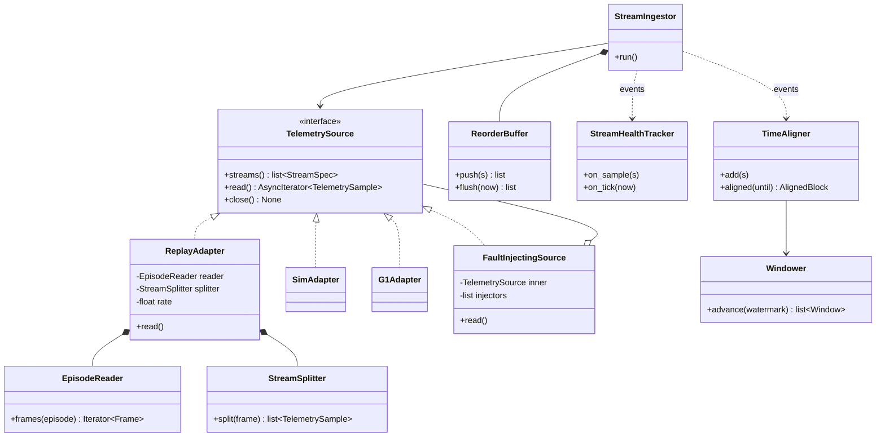

# Sources and ingestion

!!! proposed "Proposed"
    Implements FR1–FR10. Depends on the [dataset facts](../overview/dataset.md).

## Classes



The interface offers `read` and no way to write, which is how NFR17 is enforced by construction.

## ReplayAdapter

`EpisodeReader` is the **only** class that knows the dataset format. It loads through the publishers' `Dataloader`, checks `robot_type`, and converts each frame into named arrays.

!!! warning "Traps confirmed in the data"
    - In LeRobot formats, `action[0:14]` is **hands** and `action[14:28]` is **arms**. Test this with a golden file.
    - In the LeRobot formats, timestamps are synthetic: use frame index / 30 for those, and `time` only for raw.
    - Full LeRobot data is a mix of G1 and H1; filter it explicitly.

`StreamSplitter` turns one frame into per-stream samples, each with its own rate and jitter (FR10). Rates can only go down from the 30 Hz of the recording.

```yaml
replay:
  rate: 1.0                    # 1x to at least 5x (FR9)
  pace: wall                   # wall (uses sleep) or virtual (driven by VirtualClock)
  chain_episodes: true
  streams:
    joint.arm: {divisor: 1, jitter_ms: 2}
    cmd.arm:   {divisor: 1, jitter_ms: 2}
    imu:       {divisor: 1, jitter_ms: 1}
    pressure:  {divisor: 2, jitter_ms: 5}   # 15 Hz
    odometry:  {divisor: 3, jitter_ms: 5}   # 10 Hz
  seed: 42
```

### Chaining episodes

Since episodes average about 14.6 s, sessions and long-run tests need several in sequence. At each join the adapter emits `EpisodeBoundary` and keeps source time running forward with a small gap. Joints jump between episodes, which must not look like a fault, so consumers react to the boundary:

| Consumer | Reaction |
|---|---|
| `Windower` | Discards the partial window; the next window starts after the boundary |
| Rules with state (`drift`, baselines) | Reset per-episode state |
| Health tracker | Excludes the gap from staleness and loss counts |
| Injected faults | Keep running by source time, so one fault can span a boundary |
| Diagnostic engine | Keeps its states, since the session continues |

Whether a faulty joint's evidence collapses at a boundary should be tested: it must not clear a diagnosis just because a window was discarded. Fusion handles this because a gap shorter than the evidence TTL keeps the last values.

## Ingestion

### StreamIngestor

There is one task per stream (FR2). For each sample it stamps `receive_time` from the clock (FR3) and pushes it into its `ReorderBuffer`. It publishes `TelemetryReceived` for whatever comes out.

### ReorderBuffer

A min-heap keyed by `source_time`, using a per-stream **watermark**: `watermark = max(source_time seen) − W_late`.

```python
def push(self, s: TelemetrySample) -> list[TelemetrySample]:
    if s.source_time <= self._released_up_to:      # too late to place (FR6)
        self._late_count += 1
        return []
    heappush(self._heap, (s.source_time, s.seq, s))
    self._max_seen = max(self._max_seen, s.source_time)
    watermark = self._max_seen - self._w_late
    return self._pop_until(watermark)              # in source order (FR5)

def flush(self, now: TimeNs) -> list[TelemetrySample]:
    """Release everything when the stream goes silent, so that a dead stream
    cannot hold back samples that have already arrived."""
```

Duplicates with the same `(stream, seq)` are dropped and counted.

### StreamHealthTracker

Implements the [stream health state machine](../requirements/state-machines.md#health-of-a-telemetry-stream). Over a 2 s sliding window it tracks:

- **Loss ratio**, from sequence gaps: `(expected − received) / expected`.
- **Late ratio**, from the reorder buffer's counters.
- **Delay**, as the 95th percentile of `receive_time − source_time`, minus a baseline offset measured at the start of the session. Clocks may differ, so absolute values are not meaningful.

It publishes `StreamHealthChanged` and evidence on `stream.<id>`:

| Condition | Evidence | Score |
|---|---|---|
| Loss ratio over ρ<sub>deg</sub> | F14 | Rises with ratio |
| Delay over d<sub>max</sub> | F13 | Rises with delay |
| Reorder rate over threshold | F15 | Rises with rate |
| STALE | F16 | 1.0 |

### TimeAligner

Builds a common time grid at `1/30 s` (FR4), using zero-order hold for lower-rate streams, up to a stream-specific maximum age. Past that age the value is masked. **Gaps are not interpolated across** (FR7). Each signal gets a boolean mask, so a check always knows which values are real.

Note the rule on NaN: the aligner preserves it, and it is the `missing_data` rule that reports it. An aligned NaN differs from a masked gap: it means the sample arrived but its contents were invalid.

### Windower

Emits a `Window` every hop, once the **joint watermark** passes its end. That watermark is the minimum over streams of each stream's watermark, *excluding STALE streams*, so that one dead stream cannot freeze the whole pipeline.

```text
           hop 0.2 s
          |<----->|
  ========[=========== window 1.0 s ===========]
                                               ^ emitted when the joint watermark passes here
```

Each window gets a new `correlation_id`, its `sample_refs` for traceability, and `missing_streams`.

## Testing

| Test | Verifies |
|---|---|
| Golden: first frames of a known episode give the expected values and indices | `EpisodeReader` |
| Property: for any shuffle within W<sub>late</sub>, output is sorted and complete | FR5 |
| Property: a sample older than W<sub>late</sub> is counted and never emitted | FR6 |
| A stream going silent reaches STALE at T<sub>stale</sub>, and windows still appear | FR7 |
| NaN values pass through without exceptions and stay visible | FR8, NFR4 |
| Aligned output with masks over streams at 30, 15 and 10 Hz | FR4 |
| Replay at 5× produces five times the sample rate | FR9 |
| Same seed gives the same jitter | FR16 |
| A boundary gives no false evidence, no partial windows | Episode chaining |

**Next:** [Fault injection](fault-injection.md)
