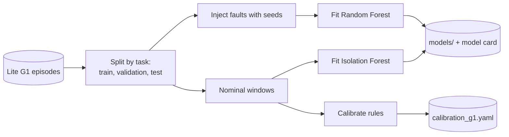

# ML detectors

!!! proposed "Proposed"
    Implements FR18 and FR23. The proposal names Isolation Forest and Random Forest as candidates. The project's aim is the architecture, so these models stay deliberately simple.

## Two kinds of model

| Model | Used as | Trained on | Output |
|---|---|---|---|
| Isolation Forest, per body region | `MLDetector`: anomaly evidence | Nominal windows only | Score per region, assigned to joints by attribution |
| Random Forest, per fault layer | `HypothesisRanker` in the [classifier](classify-localize.md) | Labelled windows from injection | Probability per fault type |

Labels from injection are used only **offline** by `faultguard-harness train`. At runtime, models read telemetry only, and FR15 is respected. A trained artifact holds no scenario information.

## Features

`FeatureExtractor` is a pure function shared by training and inference, so the two cannot diverge. For each joint, within a window:

| Group | Features |
|---|---|
| Value | Mean, std, range relative to joint limits |
| Dynamics | Mean absolute velocity, max absolute velocity, velocity std |
| Residual, where a command exists | Lag-compensated mean, std, max, slope |
| Spectrum | Energy in 0–2, 2–5, 5–15 Hz bands |
| Validity | Fraction of NaN or masked values |

Joints with no command get NaN-free placeholder values and an explicit `has_command = 0` feature. Models are per region, so leg and arm models do not mix.

Per-joint scores come from a simple attribution: each joint's most unusual features, measured by distance from the training mean, determine how a region's anomaly score is divided among its joints. If this proves weak, the fallback is one detector per joint, at the cost of more models.

## Training



!!! warning "Split by task, not by episode"
    Episodes of one task resemble one another. A random split lets the model see the test task during training, which inflates every metric. Use the same split for rules calibration and for ML.

Each artifact includes a model card: dataset revision, split, feature version, seed and validation metrics. `MLDetectorRunner` refuses to load a model whose feature version differs from the running code.

## Runtime

```python
class MLDetectorRunner:
    """Consumes WindowReady from a bound-4 COALESCE queue keyed by region."""

    async def on_window(self, window: Window) -> None:
        features = self.extractor.extract(window)                  # in the loop, fast
        scores = await self.loop.run_in_executor(self.pool, score, features)
        for ev in self.to_evidence(scores, window):
            self.bus.publish(EvidenceProduced(evidence=ev, ...))
```

A raw Isolation Forest output is not a calibrated probability. It maps to [0, 1] using the score distribution on validation nominal windows, in the same `nominal`/`critical` form [the rules use](rules.md#scoring).

If the worker crashes, the runner publishes `StageFailed`, restarts the pool up to a limit, and otherwise reports `DATA_MISSING` while the rules continue. The system simply falls back to rules, as visible evidence of a monitoring-system fault.

## Rules-only mode

FR23 is a configuration switch: `mode: rules_only` causes `PipelineBuilder` not to create `MLDetectorRunner`, and to use `SuggestionVoting` as the classifier. No component has a mode branch, so the baseline can't drift from the hybrid code.

## Testing

| Test | Verifies |
|---|---|
| `FeatureExtractor` golden output on a fixed window | Training and inference match |
| Model loads; feature version mismatch is refused | Artifact safety |
| Worker killed mid-run: system continues, fault reported | NFR5 |
| `rules_only` session creates no ML objects | FR23 |
| False-alarm rate on nominal test-task windows stays near the validation rate | Generalization |

**Next:** [Evidence fusion](fusion.md)
