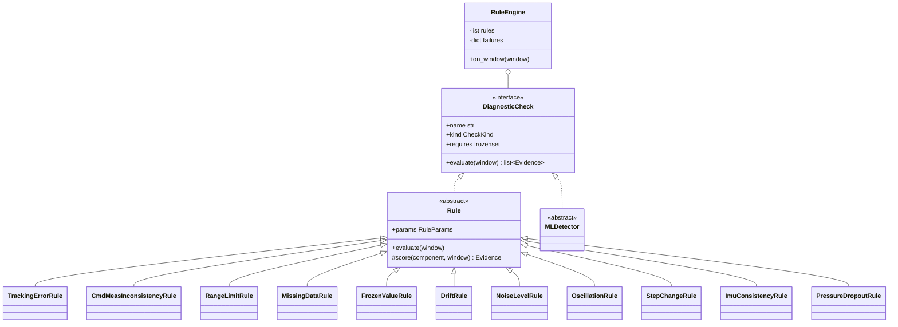

# Rules

!!! proposed "Proposed"
    Implements FR17, FR19, FR20 and FR24. FR17 fixes the first five rule types; the others are proposed to cover the catalogue.

## Interface

Rules and ML detectors share the `DiagnosticCheck` interface.

```python
class DiagnosticCheck(Protocol):
    name: str
    kind: CheckKind
    requires: frozenset[StreamId]

    def evaluate(self, window: Window) -> list[Evidence]:
        """Pure with respect to the window, apart from internal per-episode state.
        Must return DATA_MISSING evidence, not a low score, when input is masked."""
```



Stale telemetry, the fifth rule demanded by FR17, is implemented by `StreamHealthTracker`, because it needs timing information that a window doesn't hold.

## Scoring

A rule measures something physical and must express it as a score in [0, 1]. They all use the same mapping, which keeps scores comparable:

```text
score(x) = clip( (x − nominal) / (critical − nominal), 0, 1 )
```

where `nominal` is the top of the healthy range and `critical` the value at which the rule is certain. Both come from configuration or calibration.

## Rule catalogue

Window = 1.0 s. All rules return `DATA_MISSING` when the signals they require are masked.

| Rule | Applies to | Metric *x* | Suggests | FR17 |
|---|---|---|---|---|
| `tracking_error` | Joints with a command | Lag-compensated mean absolute residual over the window | F12, F10, F1, F2 | Yes |
| `cmd_meas_inconsistency` | Joints with a command | Range of command ≥ δ<sub>c</sub> while range of measurement ≤ δ<sub>m</sub> | F9, F4 | Yes |
| `range_limit` | All joints, IMU | Distance beyond physical limit | F1, F2 | Yes |
| `missing_data` | All signals | Fraction of NaN values in the window | F5, F8 | Yes |
| Stale telemetry, in `StreamHealthTracker` | All streams | Time without samples | F16 | Yes |
| `frozen_value` | Joints, IMU, odometry | Fraction of consecutive identical values | F4 | |
| `drift` | All joints | Slope of residual (with command) or of value (without), over a 5 s buffer | F2 | |
| `noise_level` | All joints | High-frequency energy against nominal | F3 | |
| `oscillation` | All joints | Peak power in 3–12 Hz of residual or signal | F11 | |
| `step_change` | All joints | Jump between neighbouring frames against nominal velocity | F1 | |
| `imu_consistency` | IMU | Quaternion norm, gravity magnitude when static, IMU `rpy` vs odometry `rpy` | F6, F7 | |
| `pressure_dropout` | Hand pressure | Sensors stuck at zero while others are active | F8 | |

## Tracking error

This is the rule most affected by the [data measurements](../overview/dataset.md#arms-follow-their-commands-with-a-large-variable-lag).

```python
def evaluate_joint(self, window, joint) -> Evidence:
    q = window.signal(joint.stream)[:, joint.index]
    r = window.signal(joint.command.stream)[:, joint.command.index]
    if window.masked_fraction(joint) > self.max_masked:
        return self.missing(joint, window)

    # Best lag inside the nominal range, re-estimated per region on a long buffer.
    # A joint-level search would let a lagging fault (F10) hide itself.
    lag = self.lag_estimator.current(joint.region)
    residual = np.abs(r[: len(r) - lag] - q[lag:])
    x = float(np.nanmean(residual))
    return self.evidence(joint, window, score(x, cal.nominal[joint], cal.critical[joint]),
                         details={"residual": x, "lag_frames": lag})
```

The rule does not emit evidence for a joint with no command (FR17 applies only where commands exist). It also holds off for one window after a large command step, when the transient would dominate.

## Calibration

`faultguard-harness calibrate` computes per-joint values on nominal training episodes. They are stored in `configs/calibration_g1.yaml` and kept with the code, so a threshold change is reviewable in a diff.

| Quantity | Default definition |
|---|---|
| `nominal` | p99 of the metric per joint |
| `critical` | 2 × nominal, at least (nominal + 0.1 rad for angle metrics) |

**Use different tasks for calibration and evaluation**, or the false-alarm rate will look better than it really is. Measured per-joint residual p99 is 0.19–0.66 rad, so these thresholds will not be small.

## RuleEngine

`RuleEngine` runs each enabled rule inline for each window, and publishes all evidence. Rules are isolated from one another:

```python
for rule in self.rules:
    try:
        for ev in rule.evaluate(window):
            self.bus.publish(EvidenceProduced(evidence=ev, ...))
        self.failures[rule.name] = 0
    except Exception as exc:
        self.failures[rule.name] += 1
        self.bus.publish(StageFailed(stage="rules", check=rule.name, error=repr(exc)))
        if self.failures[rule.name] >= self.max_failures:
            self.rules.remove(rule)   # disabled, and visible through health
```

No rule can raise an alert: the rule has no access to the alert topic, and FR20 is covered by the import-linter's independence contract.

## Testing

| Test | Verifies |
|---|---|
| Each rule: synthetic healthy window gives low score, and injected window gives a high score | FR17 |
| Each rule: masked input gives `DATA_MISSING`, not a low score | FR28 |
| `tracking_error` on recorded nominal test-task episodes: rate above nominal is at most the expected rate | Calibration |
| No evidence from `tracking_error` for a leg joint | Data constraint |
| A rule raising an exception does not stop others, and gets disabled | NFR5 |
| Rule turned off in config does not run | FR24 |

**Next:** [ML detectors](ml.md)
