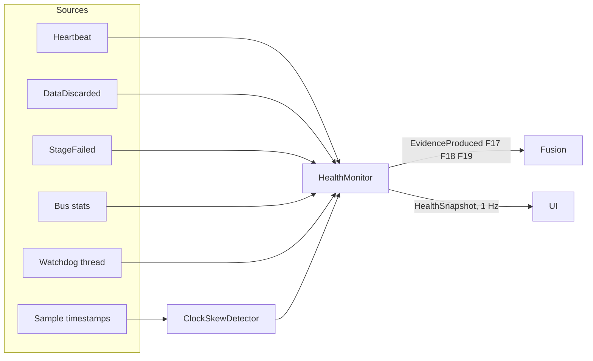

# Self-monitoring

!!! proposed "Proposed"
    Implements FR43, FR45–FR48 and NFR5.

The system treats its own faults like any other: they produce evidence on a monitored component, pass through fusion and the state machine, and reach the operator through the same alert path. No second alerting system is needed.



## Stalled components (F18, FR45)

Each `StageRunner` publishes a `Heartbeat` every second from inside its consumer loop, including when idle, so a beat proves the consumer is still taking from its queue. `HealthMonitor` raises evidence with score 1.0 on `pipeline.<stage>` after 3 s of silence, and the score returns to 0 once beats resume.

**A frozen event loop** stops every stage and also the monitor. A separate OS thread therefore watches a counter that the loop increments. If the counter stops for 3 s, the watchdog writes directly to the log and to stderr, and flags the session. Evidence is published once the loop runs again.

## Overload (F17, FR46, FR47)

`DataDiscarded` events from queues and reorder buffers are aggregated over a sliding window of 5 s:

```text
x = dropped / (delivered + dropped)
score = clip(x / overload_critical, 0, 1)       # overload_critical default: 0.2
```

Evidence goes on the owner of the queue, such as `pipeline.ml`. The details hold the number of items lost, as FR47 requires. Evidence falls as the drop rate falls, so the fault clears according to the state machine, as in S5.

Discarding by the reorder buffer means the *link* misbehaved, and is reported on the stream's health, not as overload. Only the bus's own discards are treated as F17.

## Clock skew (F19, FR48)

For each stream, the detector tracks `offset = receive_time − source_time` with a rolling median over 5 s, which absorbs jitter. Skew between streams is the largest difference from the median of all streams, compared with the value at the start of the session:

```text
skew(s) = (offset(s) − median_offset) − baseline(s)
```

Exceeding the tolerance (default 100 ms) gives F19 evidence on `stream.<id>`. If a delay fault (F13) is active on the same stream, the offset grows there too. The two faults are told apart by arrival spacing: F13 raises jitter or a temporary shift of arrival, while F19 shifts source timestamps and leaves arrival spacing unchanged.

## Health snapshot (FR43)

Published at 1 Hz, for the UI health panel.

```python
@dataclass(frozen=True)
class HealthSnapshot:
    queues: Mapping[str, QueueStat]     # depth, bound, dropped, coalesced
    streams: Mapping[str, StreamStat]   # state, rate, loss, late count, delay
    stages: Mapping[str, StageStat]     # last beat, processed, failures, enabled
    memory_mb: float
```

## Testing

| Test | Verifies |
|---|---|
| Stalling a stage gives F18 within the timeout; others continue | FR45, S9, NFR5 |
| Bus discards give F17, with the count in details | FR47, S5 |
| Overload clears after the rate drops back | S5 |
| Injected skew gives F19; injected delay does not | FR48 |
| Blocking the event loop triggers the watchdog | Frozen loop |
| Snapshot includes each queue and stream | FR43 |

**Next:** [Guided diagnosis](guided.md)
