# Scope and boundaries

!!! baseline "Baseline"
    From RASD v0.1 §1.2, which follows the World and Machine approach of Jackson and Zave.

## World and machine

Requirements are about the world; the software is the machine; the two meet only at shared phenomena. Writing this down prevents a common failure: designing around something the software cannot actually observe, such as the true condition of a joint.

```mermaid
flowchart LR
  subgraph W[World only]
    direction TB
    W1[True condition of joints and sensors]
    W2[Real physical faults]
    W3[Task and teleoperator intent]
    W4[Symptom perceived by the operator]
    W5[Ground truth of injected faults *]
  end
  subgraph S[Shared phenomena]
    direction TB
    S1[World-controlled:<br/>samples and arrival, session commands,<br/>configuration, acknowledgements,<br/>symptom reports, LLM/VLM replies]
    S2[Machine-controlled:<br/>diagnostic states, alerts, evidence trail,<br/>system health, ranked hypotheses,<br/>LLM/VLM requests, evaluation reports]
  end
  subgraph M[Machine only]
    direction TB
    M1[Telemetry windows and features]
    M2[Evidence scores and fusion]
    M3[State-machine counters]
    M4[Internal queues]
    M5[Skill registry]
  end
  W --- S --- M
```

\* Known to the Validation Harness, never to the Diagnostic System; used only by the evaluation function.

## Shared phenomena

| ID | Phenomenon | Description | Controlled by | Observed by |
|---|---|---|---|---|
| SP1 | Telemetry samples | Measured joint angles, commanded joint targets and feed-forward torques, IMU, odometry, hand pressure, RGB-D frames and LiDAR, each with the source timestamp assigned by the robot | World | Diagnostic System |
| SP2 | Sample arrival | The time at which each sample is received, the order of arrival, and the absence of expected samples | World | Diagnostic System |
| SP3 | Session commands | Selection of the telemetry source, episode, fault scenario and replay rate; start, pause and stop | World | Diagnostic System, Validation Harness |
| SP4 | Alert acknowledgement | The operator's acknowledgement of a confirmed diagnosis | World | Diagnostic System |
| SP5 | Symptom report | A natural-language description of a symptom observed by the operator | World | Diagnostic System |
| SP6 | Configuration | Fault scenarios, thresholds, enabled checks, fusion and overload policies, as configuration files | World | Diagnostic System, Validation Harness |
| SP7 | LLM/VLM replies | Plans and reasoning returned by the external service | World | Diagnostic System |
| SP8 | Diagnostic state display | The current diagnostic state of every monitored component and body region | Machine | Operator |
| SP9 | Alerts | Notification of a confirmed diagnosis: component, fault type, confidence and time | Machine | Operator |
| SP10 | Evidence trail | The evidence behind a diagnosis, including rule/ML conflicts, linked to the originating samples | Machine | Operator, Test Engineer |
| SP11 | Monitoring-system health | Queue occupancy, dropped or coalesced data, stale streams and stalled components | Machine | Operator |
| SP12 | Guided-diagnosis result | Ranked fault hypotheses with the diagnostic skills executed and their results | Machine | Operator |
| SP13 | LLM/VLM requests | Symptom, skill catalogue and skill results sent to the external service | Machine | LLM/VLM service |
| SP14 | Evaluation report | Diagnostic-quality metrics per fault class, compared with the rules-only baseline | Machine | Test Engineer |

## Telemetry sources

All sources sit behind one `TelemetrySource` interface (Adapter pattern).

| Source | Role | Status |
|---|---|---|
| `ReplayAdapter` | Replays Humanoid Everyday G1 recordings and can split frames into independent per-sensor streams with different rates and jitter | Main development path |
| `SimAdapter` | MuJoCo, for closed-loop scenarios | Optional; second in line to be cut |
| `G1Adapter` | Live robot data | Optional, only if hardware access allows |

## Out of scope

- Creating physical faults on the robot hardware.
- Automatic recovery or any actuation of the robot, including by the diagnosis orchestrator. The system only observes.
- Training locomotion or manipulation policies.
- Remaining Useful Life prediction.
- Thermal or current-based actuator faults, because temperatures and motor currents are not in the data.

**Next:** [Telemetry data](dataset.md)
