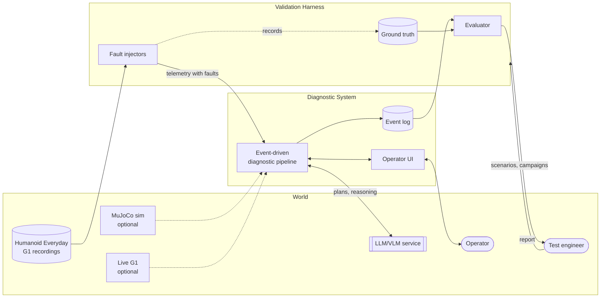
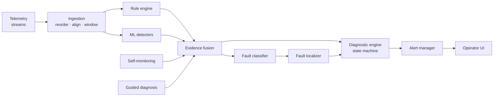

# System at a glance

This page gives the whole system in one read. Later sections refine each part.

## Two programs with different roles

The software has two parts, and the separation between them is what keeps the evaluation honest.

- **Diagnostic System**: the machine proper. It observes telemetry, produces evidence, keeps a diagnostic state for each monitored component, raises alerts, supports guided diagnosis and monitors its own health.
- **Validation Harness**: replays recorded episodes, injects controlled faults, and evaluates diagnoses against the injected ground truth.

From the Diagnostic System's point of view, the harness belongs to the world: it plays a faulty robot behind a degraded link. **The Diagnostic System never reads the ground truth.** Only the evaluation function does.

## From telemetry to alert

No single prediction raises an alert. Each stage publishes evidence, and only the state machine can confirm a diagnosis.

In the same order:

1. **Ingestion** accepts each stream on its own schedule, puts late samples back in order within a bounded window, aligns the streams on a common time base and cuts sliding windows. It marks missing data as missing and never invents it.
2. **Checks** evaluate each window. Rules are deterministic, ML detectors are statistical, and both report through the same interface.
3. **Evidence fusion** combines the scores per component and flags disagreement between rules and ML as an explicit conflict.
4. **Classification and localization** turn anomalous evidence into ranked fault hypotheses, located on a joint, sensor, stream or pipeline component, and on a body region.
5. **The diagnostic engine** runs one state machine per component, with hysteresis and dwell times, and is the only part that can confirm a diagnosis.
6. **Alerts** reach the operator, who acknowledges them and can inspect the evidence trail down to the samples.

Two contributors feed in from the side: **self-monitoring**, which treats the pipeline's own faults like any other, and **guided diagnosis**, which runs read-only tests from an operator's description of a symptom.

## The lifecycle of a diagnosis

HEALTHY → SUSPECTED → CONFIRMED → ACKNOWLEDGED → CLEARED

Evidence moves a component along this path. Moving from CONFIRMED to ACKNOWLEDGED needs a person. Full detail is under [state machines](../requirements/state-machines.md).

## The ideas that shape the design

| Idea | What it means in practice | Why |
|---|---|---|
| Immutable domain events | Components communicate only through typed events on a bus and share no mutable state | Isolation, testability, replay |
| Bounded everything | Every queue has a bound and a declared overflow policy | Overload degrades visibly instead of crashing |
| Evidence, not verdicts | Checks report scores; only the state machine decides | Stability, and a clear place to resolve conflict |
| Open for extension | Injectors, rules, detectors, skills and sources load from configuration behind stable interfaces | The primary objective |
| Traceable by construction | Every event records what caused it | An alert can be followed back to its samples |
| Read-only by construction | Source and skill interfaces offer no way to send anything to the robot | The system cannot actuate, even by mistake |

**Next:** [Scope and boundaries](scope.md)
