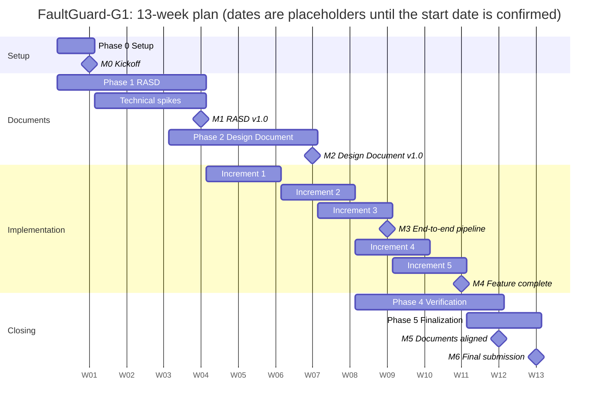

---
hide:
  - toc
---

# Roadmap

!!! baseline "Baseline"
    From the team's project plan (24 October 2026). Weeks count from the official start date, which the instructor has not yet confirmed.

The project runs 13 weeks. RASD, Design Document and implementation overlap, and the last week is buffer.

## Milestones

Each closes at the end of its week. **M3 is the critical one**, because everything after it builds on a working pipeline.

| Week | Milestone | Done when |
|---|---|---|
| W1 | M0 Kickoff | Repo created and instructor invited, LaTeX project set up, tech stack decided, roles agreed |
| W4 | M1 RASD v1.0 | All RASD sections, diagnostic FSM and sequence diagrams pushed to main, reviewed by all three |
| W7 | M2 Design Document v1.0 | Component, class and runtime views, patterns, traceability and test plan pushed to main |
| W9 | M3 End-to-end pipeline | Replayed data with an injected fault reaches CONFIRMED and raises an alert; automated tests pass |
| W11 | M4 Feature complete | Planned faults, rules + ML fusion, backpressure and operator UI working |
| W12 | M5 Documents aligned | RASD and Design Document updated to v1.1 to match the code; installation instructions written |
| W13 | M6 Final submission | Everything on main before the deadline; demo and presentation rehearsed |

**Follow the steps:** [Step-by-step playbook](playbook.md)
