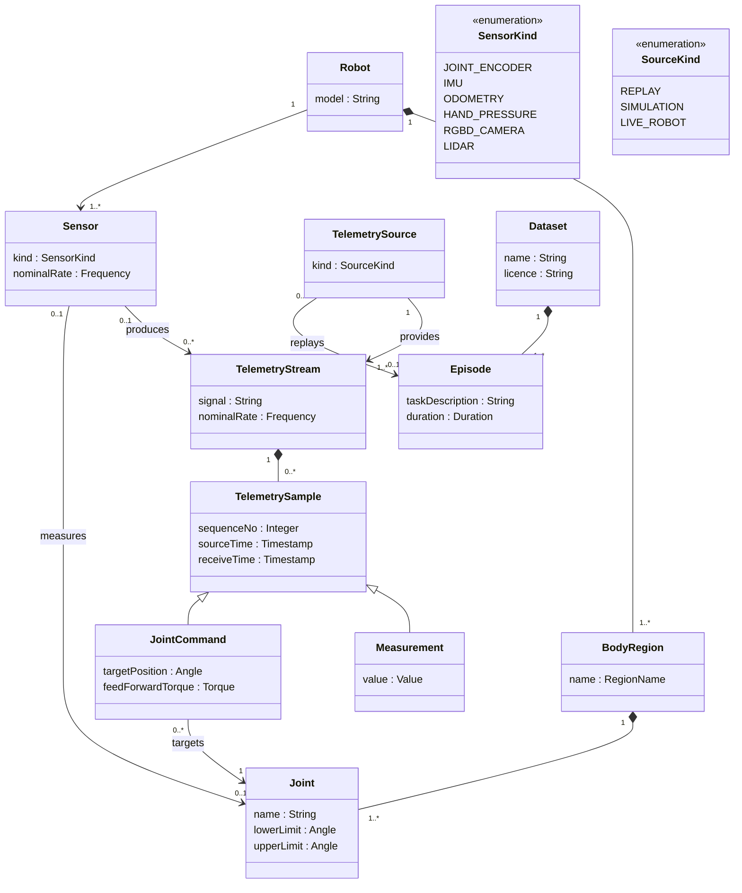
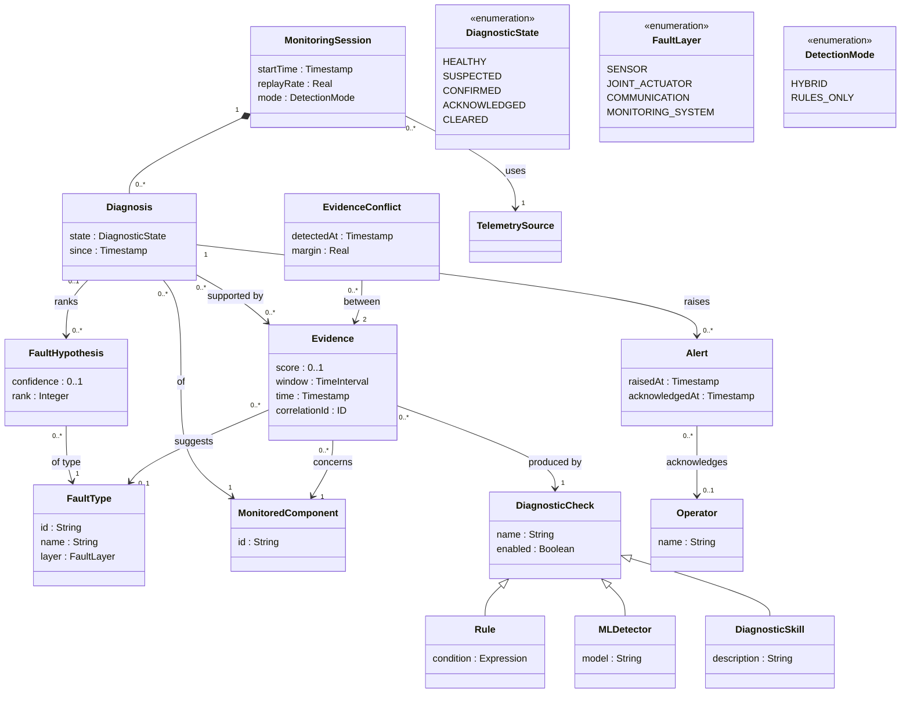
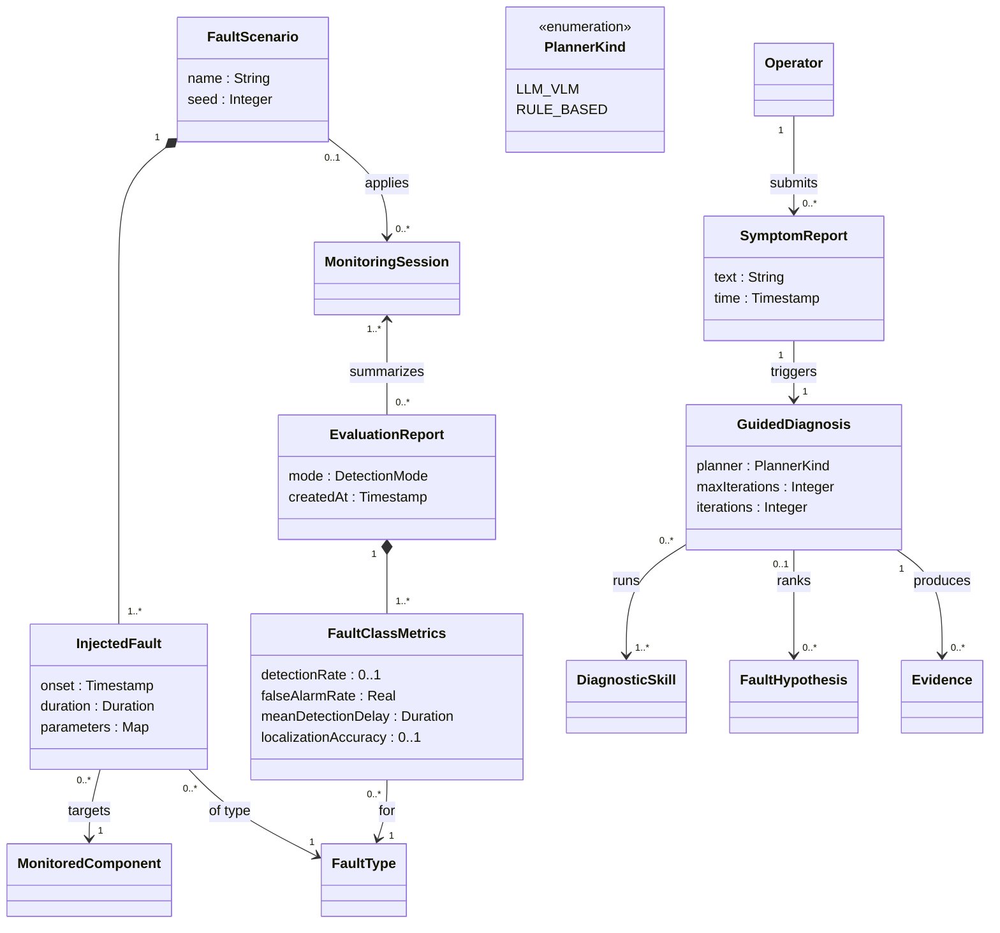

---
hide:
  - toc
---

# Domain model

!!! baseline "Baseline"
    From RASD v0.1 §2.2. The domain model describes concepts of the problem, independently of design decisions. Design classes are under [low-level design](../design/index.md).

## Robot and telemetry

A `Robot` is composed of `BodyRegion`s (left and right arm, left and right leg, waist, left and right hand), each composed of `Joint`s with position limits. The robot carries `Sensor`s; a joint encoder measures exactly one joint. Each sensor produces a `TelemetryStream` with a nominal rate; command streams are produced by the robot's controller rather than a sensor. A stream is a sequence of `TelemetrySample`s, each a `Measurement` or a `JointCommand`. A `TelemetrySource` provides the streams of one robot, and can be a replay of an `Episode` of a `Dataset`, a simulation or the live robot.

!!! note
    The cardinality on `Sensor`–`Joint` is simplified here: the RASD figure shows a joint encoder measuring exactly one joint. In the G1 data, `JointCommand` exists for arm and hand joints only, and `feedForwardTorque` for arm joints only; see [Telemetry data](../overview/dataset.md).

## Evidence and diagnosis

A `MonitoringSession` uses one telemetry source and runs in hybrid or rules-only mode. A `MonitoredComponent` is anything whose health is tracked: a joint, body region, sensor, stream, or a stage of the monitoring pipeline. `DiagnosticCheck`s (`Rule`, `MLDetector`, `DiagnosticSkill`) produce `Evidence` about a component over a time window, possibly suggesting a `FaultType`. When rule-based and ML evidence disagree, an `EvidenceConflict` relates them. Each component has a `Diagnosis`, supported by evidence and holding ranked `FaultHypothesis` entries. A confirmed diagnosis raises an `Alert`, which an `Operator` acknowledges.

`MonitoredComponent` is specialized by `Joint`, `BodyRegion`, `Sensor`, `TelemetryStream`, and `PipelineComponent` (a stage of the monitoring system itself).

## Fault injection, evaluation and guided diagnosis

A `FaultScenario` is composed of `InjectedFault`s, each of a fault type and targeting a monitored component over a time interval; it is the ground truth of a session. An `EvaluationReport` summarizes sessions in one detection mode, with one `FaultClassMetrics` per fault type. An operator submits a `SymptomReport`, which starts a `GuidedDiagnosis` that uses a planner, runs skills, and produces evidence and ranked hypotheses.

