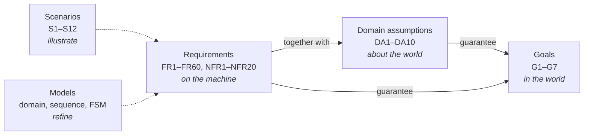

# Requirements

!!! baseline "Baseline"
    This section mirrors **RASD v0.1** (24 October 2026) so the requirements can be searched and linked from the design. The RASD remains authoritative. Comments added here are marked as notes, and the RASD's unresolved `[TODO]` items are collected in [Open decisions](../project/decisions.md).

## How the requirements fit together

The requirements guarantee the goals only if the domain assumptions hold. This is why [checking the assumptions against the real dataset](../overview/dataset.md) matters.

## Identifier scheme

The same IDs are reused in the Design Document traceability tables and in test names, so a test name alone tells you what it verifies.

| Prefix | Meaning | Count | Page |
|---|---|---|---|
| G | Goal | 7 | [Objectives](../overview/objectives.md#goals) |
| SP | Shared phenomenon | 14 | [Scope](../overview/scope.md#shared-phenomena) |
| S | Scenario | 12 | [Scenarios](scenarios.md) |
| F | Fault type | 19 | [Fault catalogue](fault-catalogue.md) |
| FR | Functional requirement | 60 | [Functional](functional.md) |
| NFR | Non-functional requirement | 20 | [Non-functional](non-functional.md) |
| DA | Domain assumption | 10 | [Assumptions](assumptions.md) |
| T | Diagnostic state-machine transition | 7 | [State machines](state-machines.md) |

## Map: goals to requirements

| Goal | Requirements | Assumptions |
|---|---|---|
| G1 | FR4, FR7, FR8, FR17, FR18, FR19, FR21, FR25, FR26, FR27, FR28, FR29, FR30, FR31, FR33, FR34, FR37, FR38, FR39, FR40, FR41; NFR1, NFR2, NFR8, NFR18, NFR19 | DA2, DA3, DA4, DA5, DA7, DA10 |
| G2 | FR20, FR21, FR22, FR26, FR28, FR31, FR32, FR33, FR35, FR36, FR52, FR53; NFR7 | DA2 |
| G3 | FR1, FR2, FR3, FR5, FR6, FR7, FR8, FR43, FR45, FR46, FR47, FR48, FR56; NFR3, NFR4, NFR5, NFR6 | DA3, DA4, DA9 |
| G4 | FR1, FR12, FR24, FR36; NFR10, NFR11, NFR12, NFR13 | none |
| G5 | FR3, FR19, FR22, FR42, FR44, FR55; NFR14 | DA3 |
| G6 | FR9, FR10, FR11, FR12, FR13, FR14, FR15, FR16, FR23, FR54, FR57, FR58, FR59, FR60; NFR8, NFR15, NFR16 | DA1, DA6, DA9 |
| G7 | FR49, FR50, FR51, FR52, FR53, FR54, FR55, FR56, FR59; NFR9, NFR12 | DA8, DA7 |

!!! note
    This table reproduces RASD Table 2.17. It omits a few entries that the per-requirement Goals column does list; see [RASD findings](../project/rasd-review.md#consistency-findings).
