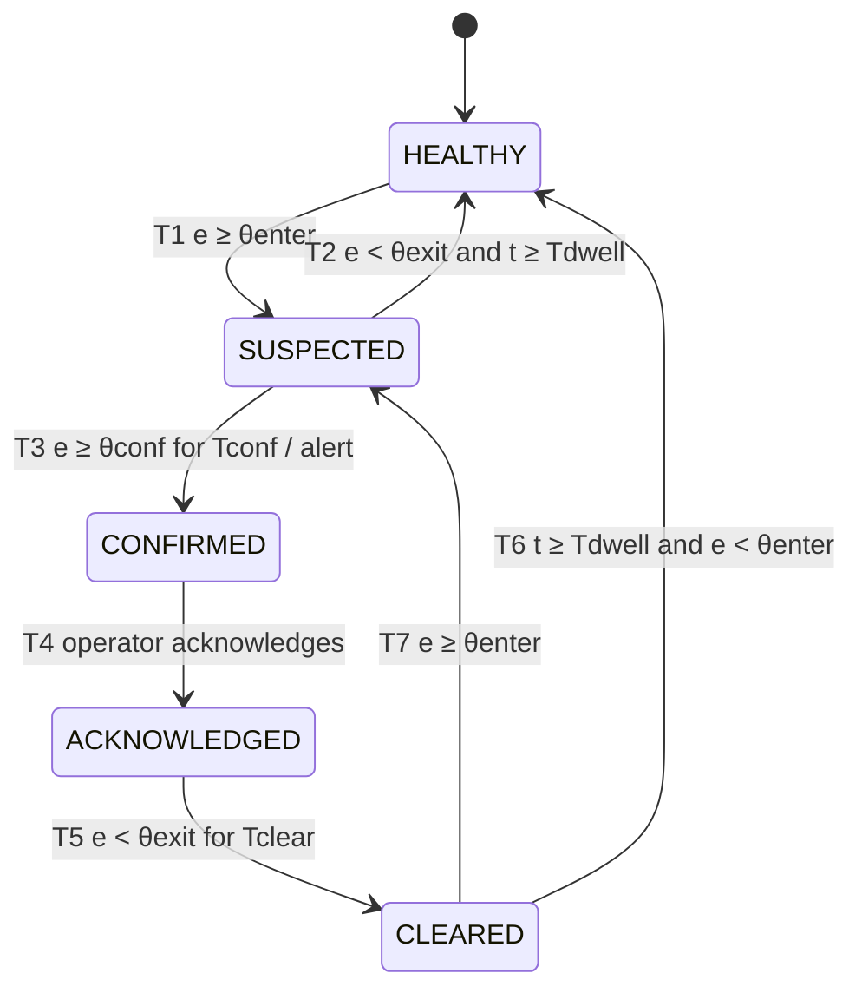
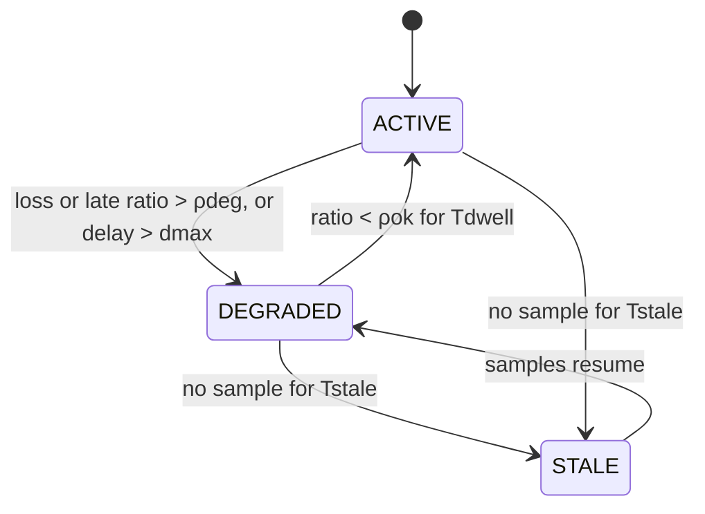

# State machines

!!! baseline "Baseline"
    From RASD v0.1 §3.2. The implementation design is under [Diagnostic engine](../design/diagnostic-engine.md).

## Diagnostic state of a monitored component

The system keeps one instance of this machine per monitored component (FR29). Its input is the fused evidence *e(t)* ∈ [0, 1]. Its parameters are the thresholds θ<sub>exit</sub> < θ<sub>enter</sub> ≤ θ<sub>conf</sub> and the times T<sub>dwell</sub>, T<sub>conf</sub> and T<sub>clear</sub>, configurable per class of component (FR36). The gap between θ<sub>enter</sub> and θ<sub>exit</sub> (hysteresis) and the minimum dwell time prevent oscillation (NFR7).



| # | From → To | Guard | Action |
|---|---|---|---|
| T1 | HEALTHY → SUSPECTED | e ≥ θ<sub>enter</sub> | Update display |
| T2 | SUSPECTED → HEALTHY | e < θ<sub>exit</sub> and time in state ≥ T<sub>dwell</sub> | Update display |
| T3 | SUSPECTED → CONFIRMED | e ≥ θ<sub>conf</sub> for at least T<sub>conf</sub> | Publish `DiagnosticConfirmed`; raise alert |
| T4 | CONFIRMED → ACKNOWLEDGED | Operator acknowledges | Record time; silence alert |
| T5 | ACKNOWLEDGED → CLEARED | e < θ<sub>exit</sub> for at least T<sub>clear</sub> | Update display; log resolution |
| T6 | CLEARED → HEALTHY | Time in state ≥ T<sub>dwell</sub> and e < θ<sub>enter</sub> | Update display |
| T7 | CLEARED → SUSPECTED | e ≥ θ<sub>enter</sub> | Update display; mark as recurrent |

A CONFIRMED component stays CONFIRMED until it is acknowledged, even if its evidence disappears (FR33). The user interface then marks the alert as "evidence no longer present".

!!! warning "Gap"
    T1 has no time guard, so a T2 followed at once by T1 would break NFR7. See [finding B2](../project/rasd-review.md#b2-the-state-machine-does-not-guarantee-nfr7).

## Health of a telemetry stream

This machine provides the evidence for communication faults (F13–F16). While a stream is STALE, checks that need its data report missing data, not evidence against joints or sensors (FR28). When samples resume, the stream passes through DEGRADED before it becomes ACTIVE again.



The ratio is computed over a sliding window, with ρ<sub>ok</sub> < ρ<sub>deg</sub>.

## Requirements-level sequence diagrams

The RASD treats the system as a black box in these diagrams; the internal versions are under [Runtime view](../architecture/runtime.md).

=== "Detection to acknowledgement (S2)"

    ```mermaid
    sequenceDiagram
      participant S as :TelemetrySource
      participant F as :FaultGuard-G1
      participant O as :Operator
      loop session running
        S->>F: telemetry sample
        F->>F: evaluate checks, fuse evidence
        opt e ≥ θenter
          F->>F: HEALTHY to SUSPECTED
          F-->>O: state update (SUSPECTED)
        end
        opt e ≥ θconf for Tconf
          F->>F: SUSPECTED to CONFIRMED
          F-->>O: alert (component, hypotheses), within 2 s
        end
      end
      opt operator inspects the alert
        O->>F: requestEvidence(alert)
        F-->>O: evidence trail, samples
      end
      O->>F: acknowledge(alert)
      F-->>O: state update (ACKNOWLEDGED)
      opt e < θexit for Tclear
        F->>F: ACKNOWLEDGED to CLEARED
        F-->>O: state update (CLEARED)
      end
    ```

=== "Imperfect telemetry and overload (S4, S5)"

    ```mermaid
    sequenceDiagram
      participant S as :TelemetrySource
      participant F as :FaultGuard-G1
      participant O as :Operator
      loop session running
        S->>F: telemetry sample
        opt out of order, delay ≤ Wlate
          F->>F: reorder by source time
        end
        opt delay > Wlate
          F->>F: discard and count
        end
        opt no sample on a stream for Tstale
          F->>F: mark stream STALE, data missing
          F-->>O: communication fault (stream)
        end
        opt queue full
          F->>F: apply backpressure policy
          F-->>O: monitoring-system fault (overload, discarded data)
        end
        F-->>O: health update (queues, discarded, stale streams)
      end
    ```

=== "Guided diagnosis (S12)"

    ```mermaid
    sequenceDiagram
      participant O as :Operator
      participant F as :FaultGuard-G1
      participant L as :LLM/VLM Service
      O->>F: submitSymptom("the left arm is vibrating")
      F->>L: plan(symptom, skill catalogue)
      L-->>F: selected skills
      loop not ranked and iterations < max
        F->>F: run selected skills (read-only)
        F->>L: reason(skill results)
        L-->>F: hypotheses or next skills
      end
      F->>F: publish conclusions as evidence
      F-->>O: ranked hypotheses, skills run, results
      opt no answer within timeout
        F-->>O: planner unavailable
      end
    ```

=== "Evaluation campaign (S11)"

    ```mermaid
    sequenceDiagram
      participant T as :TestEngineer
      participant H as :ValidationHarness
      participant D as :DiagnosticSystem
      T->>H: startCampaign(episodes, scenarios, seeds)
      loop each mode in hybrid, rules-only and each scenario
        H->>D: startSession(mode)
        loop episode not finished
          H->>D: telemetry sample (with injected faults)
        end
        D-->>H: event log (confirmed diagnoses)
      end
      H->>H: compare with ground truth, compute metrics
      H-->>T: evaluation report
    ```
