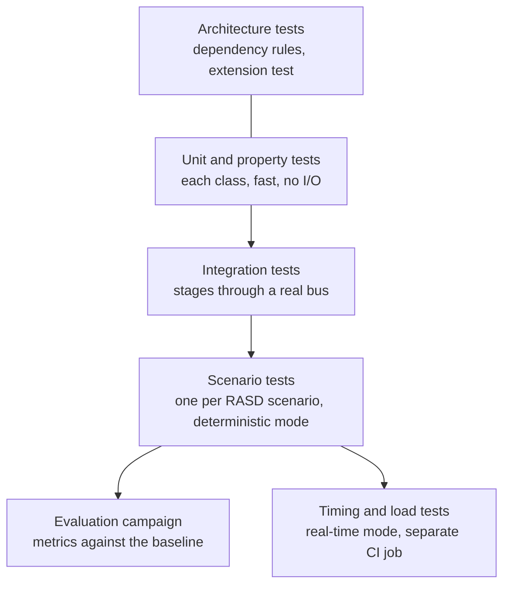
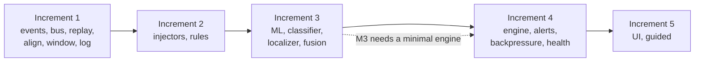

# Test strategy

!!! proposed "Proposed"
    Input for Design Document chapter 5. The plan's Phase 4 tasks are baseline.

## Levels



| Level | Scope | Runs | Tools |
|---|---|---|---|
| Architecture | Import contracts, extension test, no write operations on sources | Every push | `import-linter`, `pytest` |
| Unit and property | One class; pure logic such as the FSM, reorder buffer, queue | Every push | `pytest`, `hypothesis` |
| Integration | Several stages through a real bus, with a `VirtualClock` | Every push | `pytest-asyncio` |
| Scenario | S1–S12 from the source onward, on a small committed fixture | Every push | `pytest`, deterministic mode |
| Timing and load | NFR1–NFR3, NFR6, real-time mode | Manually, and before each milestone | Scripts, event-log analysis |
| Evaluation | Metrics on held-out tasks | Milestones | `faultguard-harness campaign` |

Each RASD scenario should have an automated test, so that verification doesn't depend on manual runs.

## Naming ties tests to requirements

```python
def test_FR31_confirms_after_tconf_of_high_evidence(): ...
def test_NFR7_hs_transitions_are_at_least_tdwell_apart(): ...
def test_S4_imu_loss_raises_no_joint_fault(): ...
```

A small script compares IDs in test names with the RASD's IDs and prints which requirements have no test, which feeds [Traceability](traceability.md).

## Test fixtures

CI cannot download the dataset. Commit a tiny fixture: a few seconds from two or three episodes, with the same fields as the raw format, plus a synthetic generator for property tests. The fixture must come from an MIT-licensed part of the dataset, and its source should be recorded in the repository.

## Integration order

Integration follows the plan's increments, always keeping a walking pipeline. Each increment adds one or more stages, with a stub or fake for whatever isn't there yet.



!!! warning "Milestone M3 needs the engine earlier than the plan's order"
    M3 at the end of W9 requires data to reach CONFIRMED and raise an alert, but Increment 4 covers W9–W10. The engine's pure state machine and a minimal alert must therefore be done by mid-W9. Plan them first in Increment 4, with backpressure and health after M3. Alternatively, build `ComponentFsm` early, since it has no dependencies.

## Scenario test matrix

| Scenario | Automated assertion | Key requirements |
|---|---|---|
| S1 | No CONFIRMED anywhere; no drops | FR29, NFR8 |
| S2 (revised) | Joint goes through all states in order; alert has correct component; confirm before deadline | FR30–FR35, FR39 |
| S3 | F4 and F9 both in hypotheses; localized to elbow and arm | FR26, FR27 |
| S4 | Stream reaches STALE; stream fault confirmed; no joint alert | FR5–FR7, FR28 |
| S5 | Queue depth ≤ bound throughout; F17 confirmed; count present; clears after | FR46, FR47, NFR3 |
| S6 | Transition spacing ≥ T<sub>dwell</sub> | NFR7 |
| S7 | Conflict event present, both evidence IDs kept | FR22 |
| S8 | Both faults diagnosed; metrics separate | FR14, FR57 |
| S9 | F18 on classifier; other evidence continues; joint alert still possible | FR45, NFR5 |
| S10 | Sample plugin works with no source file changed | NFR10, NFR11 |
| S11 | Report has all metrics for both modes; repeat run matches | FR57–FR60, NFR15 |
| S12 | With the stub: correct skills, F11 first, state not changed directly | FR49–FR55 |

## Definition of done for any task

- [ ] Code merged by pull request, reviewed by another member
- [ ] Tests named by requirement ID, passing in CI
- [ ] `ruff`, `mypy` and `import-linter` pass
- [ ] Documents updated if behaviour differs from them
